# Design reference: how the best data sites work

A study of about forty statistics, economic-data, explainer, budget and regional sites, written to build design
intuition for the LUMS DataLab portal. It describes what each site does well and badly **and why**, and the patterns
that recur across them. The design brief that turns this into decisions is `docs/DESIGN.md`; this file is the
evidence behind it and is meant to be read on its own, in any order.

- **When:** 14 and 15 November 2026. Sites change; every observation is dated to these two days.
- **How:** eight researchers worked in parallel, each on one group of sites, doing real tasks ("find the latest
  annual inflation, chart ten years, download it, cite it", "find federal health spending", "see how a figure was
  revised") and counting clicks. Screenshots come from a headless Chromium at 1280×800 (desktop) and 390×844
  (phone, Android user agent, touch). Cookie banners were rejected, never accepted; nothing was logged into; no form
  was submitted except search boxes. Text was read with the pages' own rendering, WebFetch and, for Eurostat, its
  public API.
- **Measurements:** the requests left from a Pakistani connection. Page weights in the per-site notes are a quick
  first-screen measure (an undercount where servers omit sizes). The careful numbers are in
  [Measurements](#measurements): real bytes on the wire, with the network and CPU slowed to a mid-range Android
  phone on a poor 4G or 3G connection. Treat the seconds as optimistic; real budget phones are slower.
- **Images:** `docs/design-reference/img/`, WebP, cut to the first screen or two. They are for internal design
  study; the sites' visual identities are theirs. The full set of 350 raw screenshots and the scripts that took
  them are not in the repo.
- **What could not be checked** is listed at the end of each site and in [Limits](#limits). Where a description
  comes from documentation or press rather than use, it says so.

Contents

1. [Our site today](#1-our-site-today)
2. [Patterns across the sites](#2-patterns-across-the-sites) (the part to read if you read one part)
3. [Site by site](#3-site-by-site)
   - [Economic data tools](#31-economic-data-tools): FRED, ALFRED, ECB, OECD, IMF, World Bank
   - [National statistics offices](#32-national-statistics-offices): ONS, Statistics Canada, ABS, Stats NZ, US Census, Eurostat, BLS, BEA
   - [Explainers](#33-explainers): Our World in Data, Gapminder, USAFacts, Ember, Dataful, and two to learn from critically
   - [Budget and fiscal transparency](#34-budget-and-fiscal-transparency): USAspending, Fiscal Data, vulekamali, GC InfoBase, Open Budgets India, OpenSpending, Finance Division, UK PESA
   - [South Asia](#35-south-asia): PBS, SBP, Finance Division, Bangladesh, Sri Lanka, India, Pakistani independents
   - [Evidence and versioning outside statistics](#36-evidence-and-versioning-outside-statistics): Wikipedia, FEC, ProPublica, Full Fact, Zenodo, Dataverse, PubMed and others
4. [Measurements](#measurements)
5. [Pakistani users: devices and networks](#pakistani-users-devices-and-networks)
6. [Sources and further reading](#sources-and-further-reading)
7. [Limits](#limits)

---

## 1. Our site today

Live at `lums-datalab-portal.vercel.app`, release `v0.0.1-prototype`, the October "data lab" rebuild (S16).
Looked at with the same eyes and tools as everyone else.

| Desktop home | Phone home |
|---|---|
| 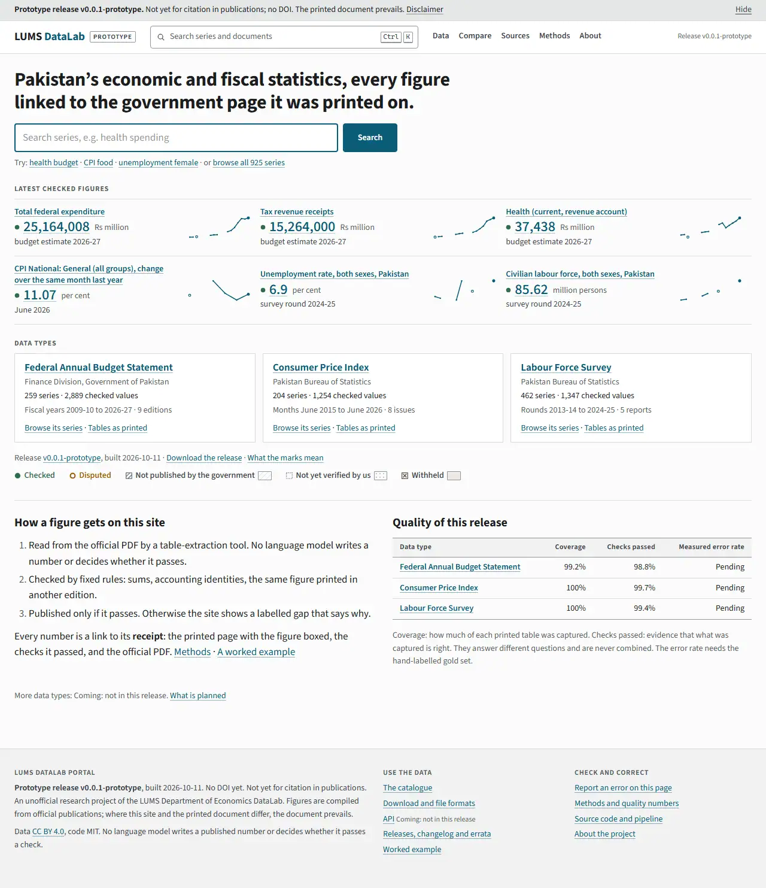 | 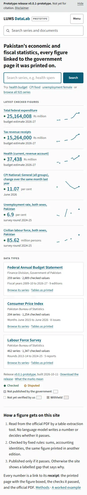 |

**What is already good, and rarer than you would think:**

- **Pages are fast on a bad connection.** On an emulated mid-range phone at 400 kbps, our series page shows its
  number and chart in about 3 seconds. FRED, Our World in Data, the World Bank, the IMF and the US Census take 37 to
  56 seconds; the Pakistan Bureau of Statistics (PBS) takes over a minute and a half. The reason is that our charts
  are SVG drawn on the server, and the page works with JavaScript off. See [Measurements](#measurements).
- **The phone receipt's first screen is the best first screen in the whole study.** The figure, its unit and kind
  ("budget estimate for 2026-27"), and a magnified crop of the printed page with the figure boxed, all without a tap.
  Nobody else in statistics shows the printed cell. The closest public precedents (the FEC's "Open image" per
  filing row, ProPublica's "View Filing") link the whole page and leave you to hunt.
- **No consent banner, no pop-up, no login.** On a phone, cookie banners covered a quarter to all of the first
  screen at ONS, OWID, USAFacts, the World Bank and Ember. PBS asks for a national ID number in a pop-up. We have
  the whole screen.
- **Breaks are drawn on the chart.** The line stops at the 2011-12 devolution and a banner says why. No budget site
  in the study does this.

| Series page, desktop | Series page, phone | Receipt, phone |
|---|---|---|
| 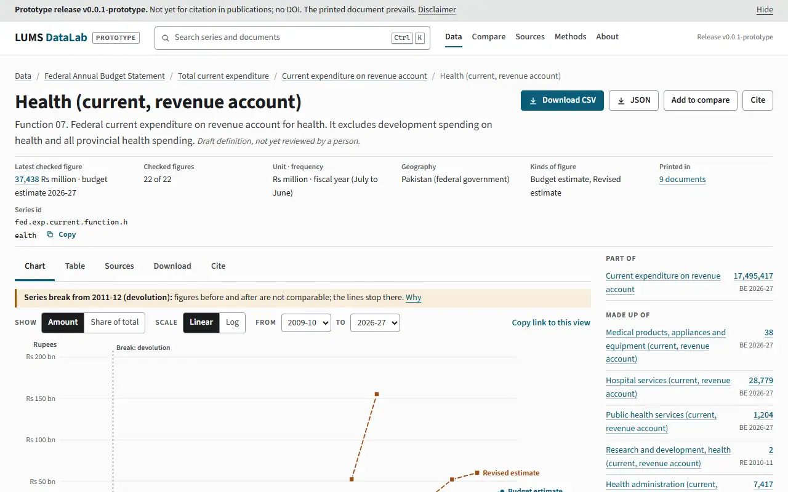 | 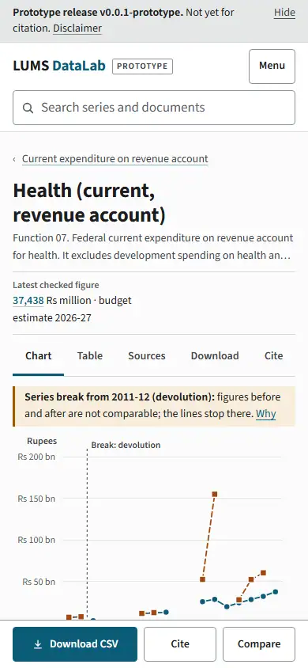 | 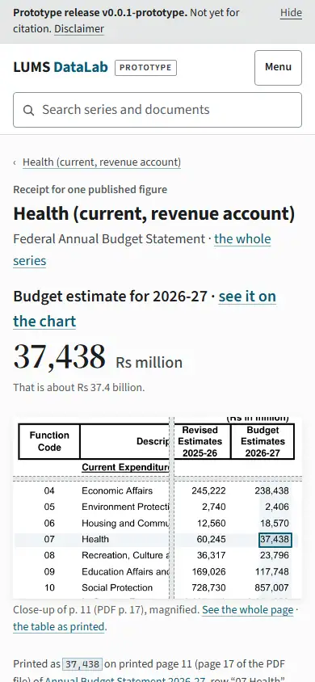 |

| Receipt, desktop | Compare, desktop |
|---|---|
| 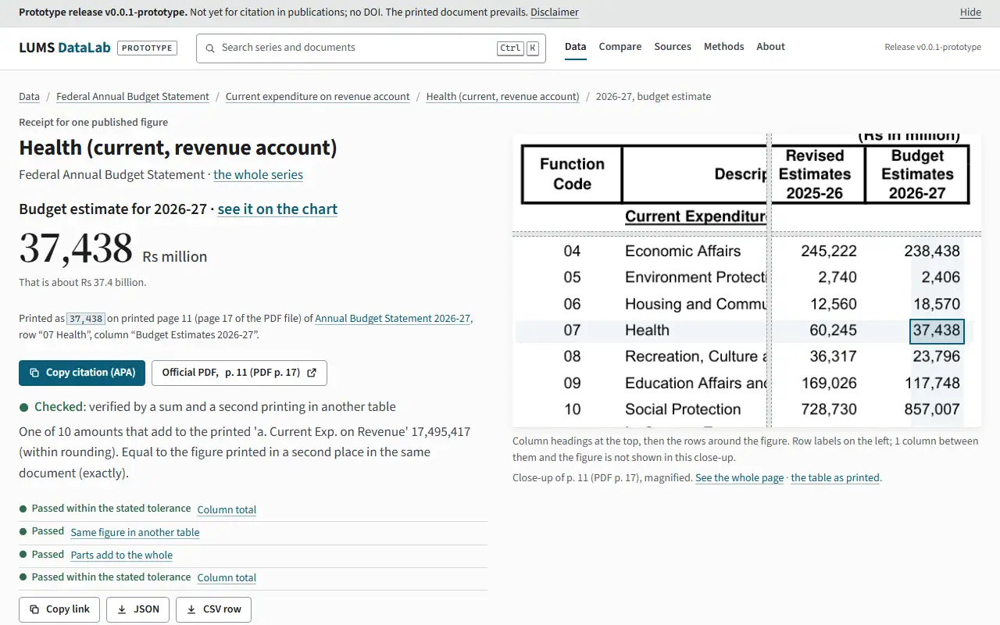 | 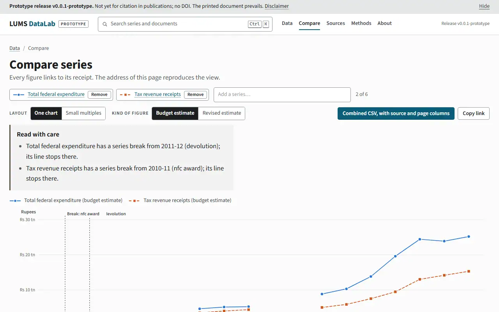 |

**Why it still reads like a yearbook.** Not because of typefaces or colours. The researchers converged on the same
causes from different directions:

1. **It is organised the way the documents are, not the way questions are.** The home page offers "Federal Annual
   Budget Statement / Consumer Price Index / Labour Force Survey" tiles, the catalogue's first facet is the data
   type, and series are named by their printed row labels ("Health (current, revenue account)", "CPI National:
   General (all groups), change over the same month last year"). A reader has to know which publication holds the
   answer before they can find it, which is exactly the PBS experience we mean to replace.
2. **It explains its process at the same depth as its answer.** The phone receipt is 8,133 px tall, about ten
   screens: arithmetic, extraction run ids and SHA-256 fingerprints sit in the same scroll as "is this number
   right?". The home page spends half its length on "How a figure gets on this site" and "Quality of this release".
   Those are true and important, and they are the methods appendix of a yearbook.
3. **The verbs of a tool are thin.** You can look at a series and download it. You cannot turn an index into a
   rate, put two series on a common basis, tap a point on a phone to read it (there is no touch tooltip), or find a
   series by plain words: "unemployment women", "tax revenue 2023", "GDP", "education spending" and any misspelling
   all return nothing. On the live site **the header search dialog is broken**: its magnifier icon has no size and
   squeezes the text box to 0 px, so nothing can be typed.

   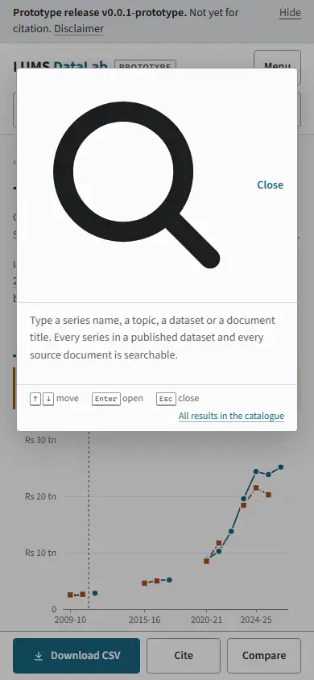
4. **Its most interesting facts are buried.** For federal health, the 2025-26 budget estimate was Rs 31,975 million
   and the revised estimate printed a year later is Rs 60,245 million, nearly double. On the receipt this appears
   only as a sidebar link with no sentence. The table-as-printed page shows the three numbers side by side and says
   nothing about them. Every budget site in the study would build a page around a revision that size.
5. **Numbers are shown as printed, not as read.** "25,164,008 Rs million" on a home card is the exact figure and
   the wrong headline: on a 360 px phone it fills the row and nobody says it that way. The receipt already does the
   right thing ("37,438 Rs million · that is about Rs 37.4 billion").
6. **Some pages are heavy for no reason anyone chose.** The home page is 330 KB, then downloads 1.67 MB more in the
   background: the framework prefetches every linked page that scrolls into view, and receipt pages pull full
   printed-page PNGs with them. The catalogue renders all 925 series at once (5.3 MB of HTML and hydration data,
   27,425 elements). Web fonts are 148 KB on every page, as much as all our JavaScript.

| Series table on a phone: five rows a screen, the status column off-screen | Search for "inflation": the index level ranks above the inflation rate |
|---|---|
| 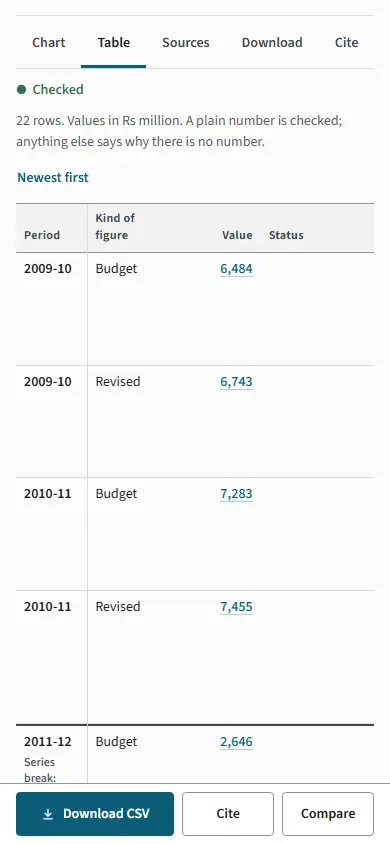 | 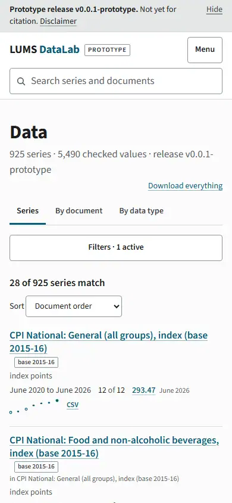 |

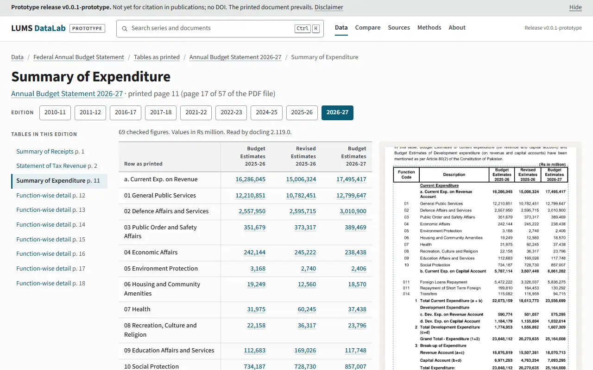

---

## 2. Patterns across the sites

Fourteen patterns, each with the best and worst examples and the reason behind them. The site-by-site notes in
section 3 are the evidence; this section is the intuition.

### 2.1 Answer first: the number before the metadata

The pages that work on a phone all put, in this order: what it is (the measure in plain words), when (the period in
words), the number, the change with its unit, one or two next actions. Metadata goes under the number.

- **Best:** the Stats NZ indicator page ("Annual change +3.7%, September 2026 year", with Updated and Next update
  above it); the ONS home-page cards (measure, period, big number, "↑ 0.3pp on previous month", then Analysis and
  Data links); the US Census instant answer ("Poverty, All People in Cambridge City, Massachusetts is 10.2% ±
  2.0%"); BEA's GDP page ("Q3 2026 (Adv) +3.4%"); USAFacts' first sentence ("The inflation rate was 4%, as of
  October 2026").
- **Worst:** the ONS legacy time-series page (no latest value anywhere in its text; you read it off the chart, two
  screens down on a phone); the ABS CPI release, Statistics Canada's table and The Daily, Eurostat's Data Browser
  (no number on the first screen); PBS (a banner and a carousel, data six screens down).
- **Why it works:** a visitor comes with one question. If the first screen answers it, everything after is optional
  depth and feels generous. If it does not, everything before the answer feels like an obstacle, however good it
  is.

| Stats NZ indicator | ONS home cards | Census instant answer | BEA GDP |
|---|---|---|---|
| 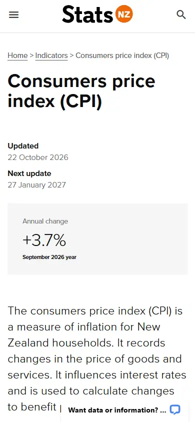 | 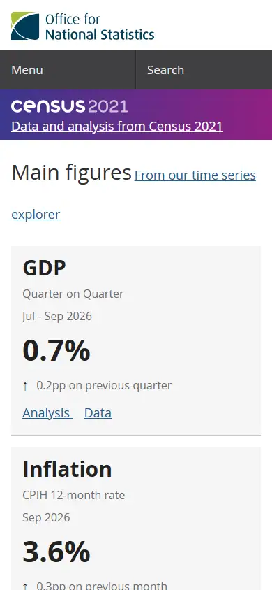 | 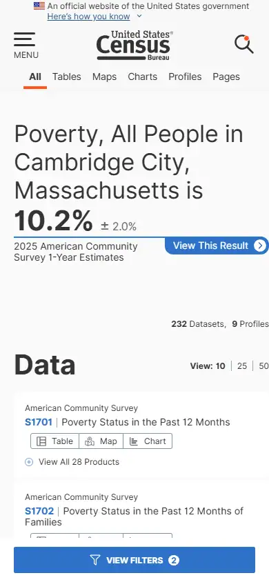 | 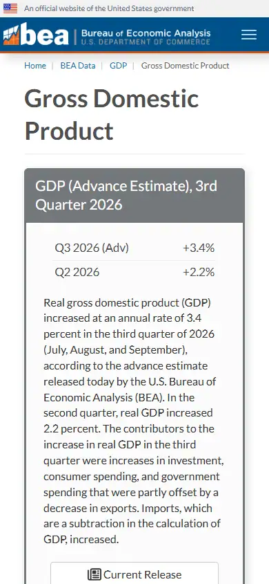 |

### 2.2 One stable page per series, with the same skeleton everywhere

FRED is the reference for economists not because it is beautiful but because every one of its 800,000 series pages
has the same skeleton: title with the ID in brackets; a fixed band with the latest value and period in bold,
updated and next-release dates, units, frequency and range buttons; the chart; then notes with a citation. The ID is
the URL, the citation handle and the API key at once. Learn the page once and you can use any series.

- The counter-example is the national statistics offices, each of which runs **three generations of tooling** on
  one site (ONS legacy pages, beta pages and the new local-statistics tool; Statistics Canada's table viewer, The
  Daily and its visualisation tools; Stats NZ's indicator pages, Infoshare and the new Data Explorer). Users relearn
  the controls on every page, and the latest tool often cannot find the most-used statistic.
- Small is an advantage here: one series page pattern for every series is cheap for us and impossible for them.

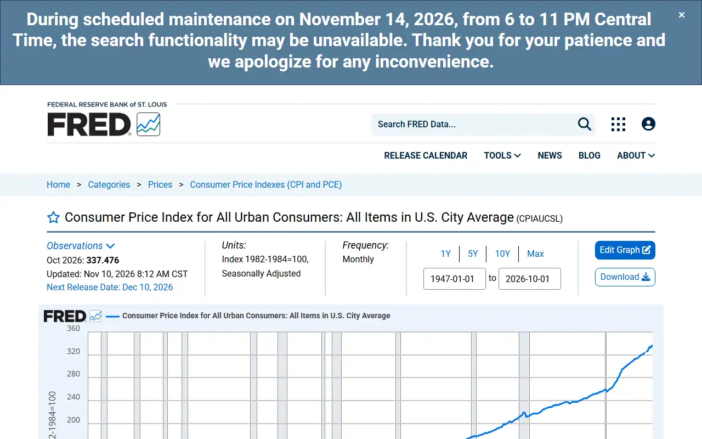

### 2.3 Evidence in layers, delivered where the number is

Every good site separates three questions and answers each at its own depth:

1. **At a glance:** who published this and is anything special about it? A one-line source inside the chart frame or
   under the number ("Data source: ... via World Bank", "Source: Bureau of Labor Statistics →").
2. **One tap, without leaving the page:** what exactly is it and how do you know? A drawer or overlay (OWID's
   sources overlay with its own URL, USAFacts' source drawer, Wikipedia's citation bottom sheet on phones).
3. **Its own page:** let me check it myself. Methods, processing notes, citation, files.

Nobody puts methodology above the chart. OWID also separates **the source's citation** from **its own** ("processed
by Our World in Data", and "with major processing" when it changed a lot), which is the same two-part split our
receipts make between the government document and our release.

The weak version of this pattern is a good delivery with a bad payload: Wikipedia's citation for Pakistan's CPI
figure is a ministry home page, and the World Bank names a database ("International Financial Statistics database,
IMF"). A provenance UI that cannot be followed is decoration. **Our payload (document, page, row, column, the image)
is better than anyone's; what we should borrow is the delivery.**

| OWID sources overlay | USAFacts source drawer | Wikipedia citation sheet |
|---|---|---|
| 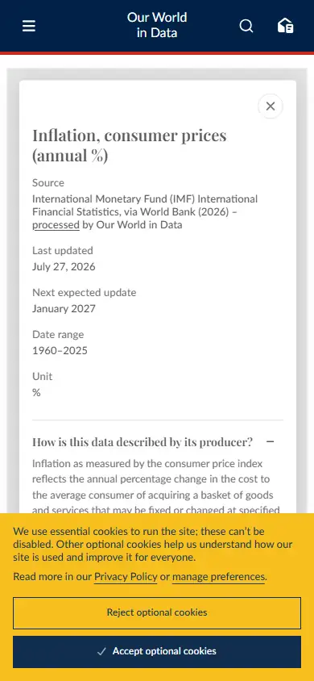 | 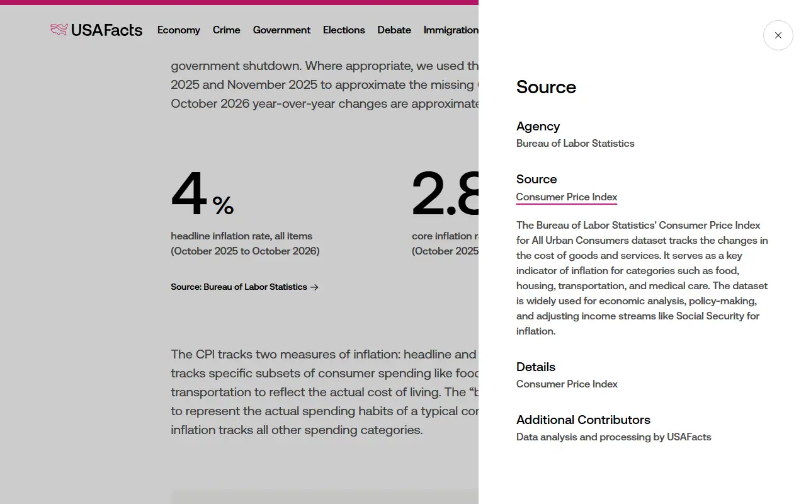 | 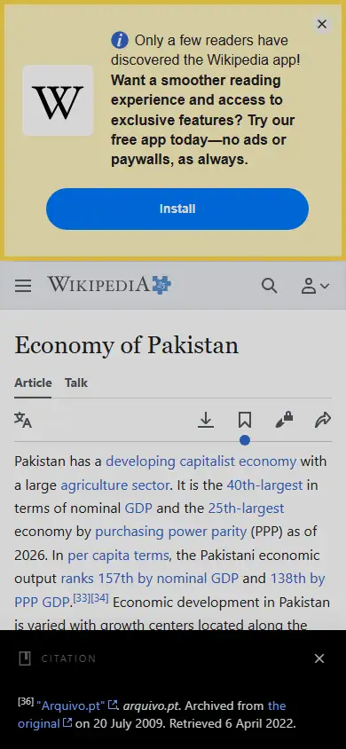 |

Research on how readers take uncertainty and caveats backs a specific style: van der Bles and others (PNAS 2020) and
Kerr and others (Royal Society Open Science 2023, about 10,000 people in 12 countries) found that **a specific,
quantified caveat barely lowers trust in the number and does not lower trust in the source, while a vague one
("could be higher or lower") lowers both.** Say exactly what is wrong or missing, with the numbers. The UK statistics
regulator renamed "experimental statistics" to "official statistics in development" in 2023 for a related reason:
the old label was read as "poor quality" when it meant "still changing".

### 2.4 Status grammar: a value plus one word, or a labelled gap

Statistics Canada publishes the clearest rule set: **replacement** symbols take the place of a value (`..` not
available for this period, `x` suppressed, `F` too unreliable to publish), and **accompanying** symbols attach to a
value (`p` preliminary, `r` revised, `E` use with caution: "132.3r"). The legend under each table lists only the
symbols that table uses. Downloads offer the flags in the cell, removed, or in a separate column.

- **BLS** decodes its flags in the table's own last row, with the reason: "X : Data unavailable due to the 2025
  lapse in appropriations". The October 2025 CPI is `(X)`, **and so is the 12-month change for October 2026**,
  because its base month is missing. The gap travels to everything computed from it.
- **Eurostat** puts `(e)` after a value and, under the table, lists only the flags present in the current view. In
  its long CSV the flag is a separate column, and every row carries the dataset version and last-update time.
- **QuickFacts** puts a warning triangle in the value cell and the vintage in the label ("July 1, 2025, (V2025)").
- **The failures:** letters alone on a phone (Statistics Canada's B and C quality grades are visible on a phone;
  their meaning is two screens down); a flag on every cell (`(p)` down a whole column is noise); a blank with no
  reason (Dataful's empty value cells, Eurostat's SDMX-CSV which simply drops missing rows unless you tick an
  option); a vintage label that disappears when you leave the headline page (BEA's interactive tables show an
  advance estimate and a third estimate identically).

| BLS: the flag decoded in the table's last row | Eurostat: legend lists only flags present |
|---|---|
| 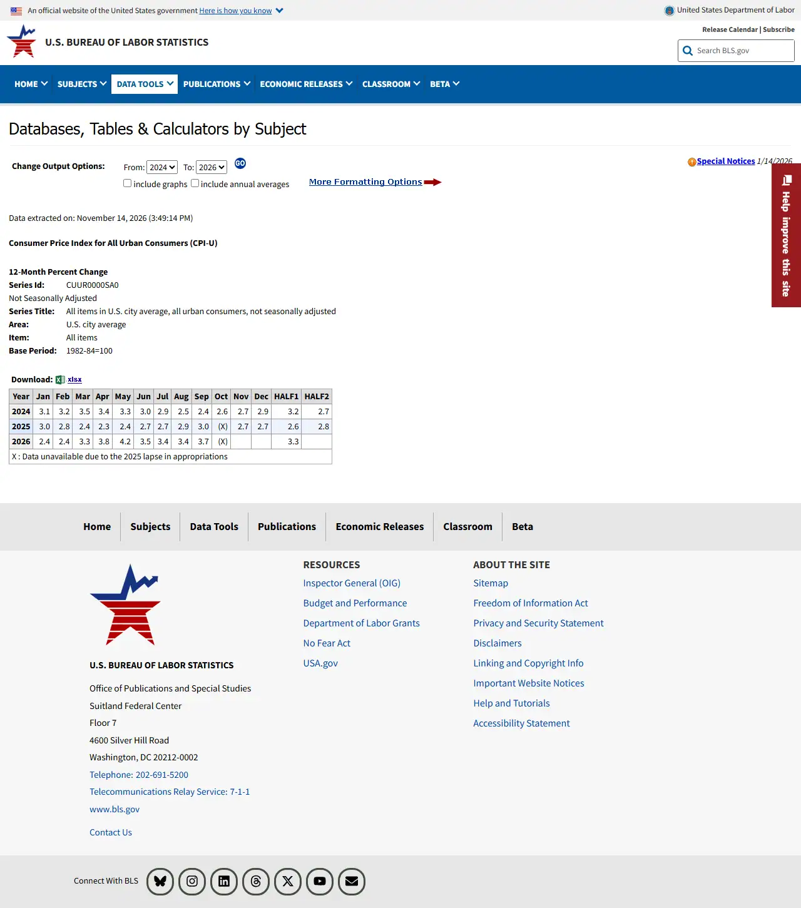 | 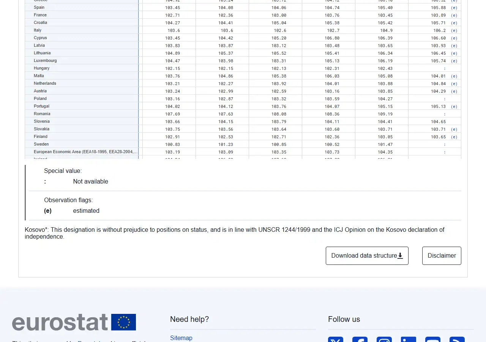 |

The lesson for us: **mark only what is not the default.** If almost everything is checked, say once per table "all
values checked unless marked" and mark the rest in words.

### 2.5 Versions: the same figure printed more than once

Two models exist, and we need both.

- **Frozen editions** (IMF WEO, OECD's snapshot links, our releases): a whole dataset gets a version number and an
  errata log. The IMF puts the version in the URL (`WEO(9.0.0)`) and lists editions as cards. Good for citation.
- **Per-value history** (ALFRED, BEA's archive, Statistics Canada's real-time tables, Eurostat's "first published"
  dataset): each value knows when it was printed and what replaced it. ALFRED offers "initial release only" and
  "real-time period" downloads; BEA's archive is a table of (period, vintage, release date); BLS and BEA publish
  **revision statistics** (mean and mean absolute revision from first to third estimate). Good for analysis.

Nobody shows revisions well to non-experts. ALFRED's default draws the two latest vintages as bars from zero, so a
revision of a few tenths is invisible. ONS keeps 132 downloadable vintages of one inflation series, every one
labelled "Scheduled update/revision", with nothing saying which values moved. No national statistics office in the
study shows the old and new value side by side on a series page.

The budget sites came closest, and South Africa's vulekamali is the model:

- **"Planned compared to historical expenditure"** draws one bar per year, the latest available phase of each, and
  beside it a card per year saying which phase it is (audited outcome, adjusted appropriation, main appropriation).
  That is the right default line for a citizen: one value per year, honestly labelled.
- **"Budget changes in the Adjusted Budget"** shows the change itself as a number ("↑0.6%, R 363 million"), with
  its breakdown. Showing the change, not two levels to compare by eye, is what makes a revision legible.

It also shows what to avoid: "Audit Outcome" and "Audited Outcome" appear as separate legend entries because the
vocabulary was never normalised across source files, and figures on the same page disagree with no check to catch
it.

| vulekamali: one bar per year, phase named per year | vulekamali: the adjustment as its own number | ALFRED: vintages as bars from zero |
|---|---|---|
| 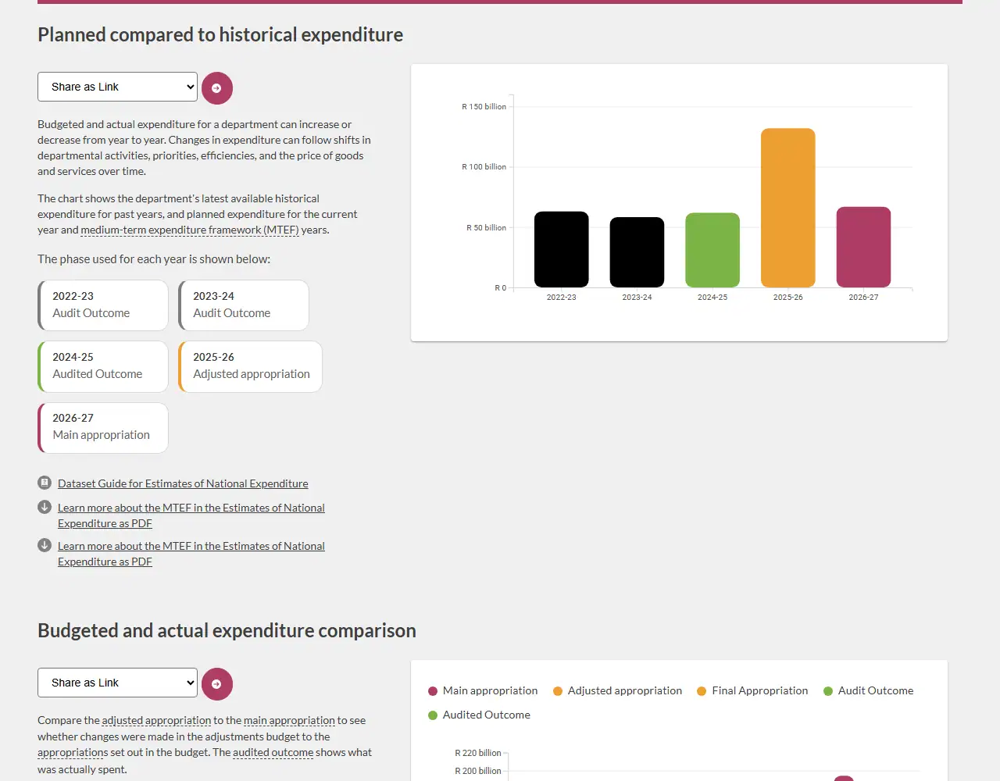 | 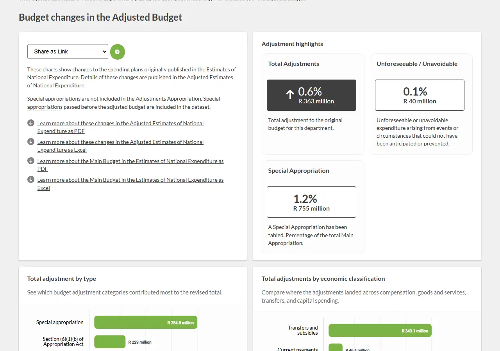 | 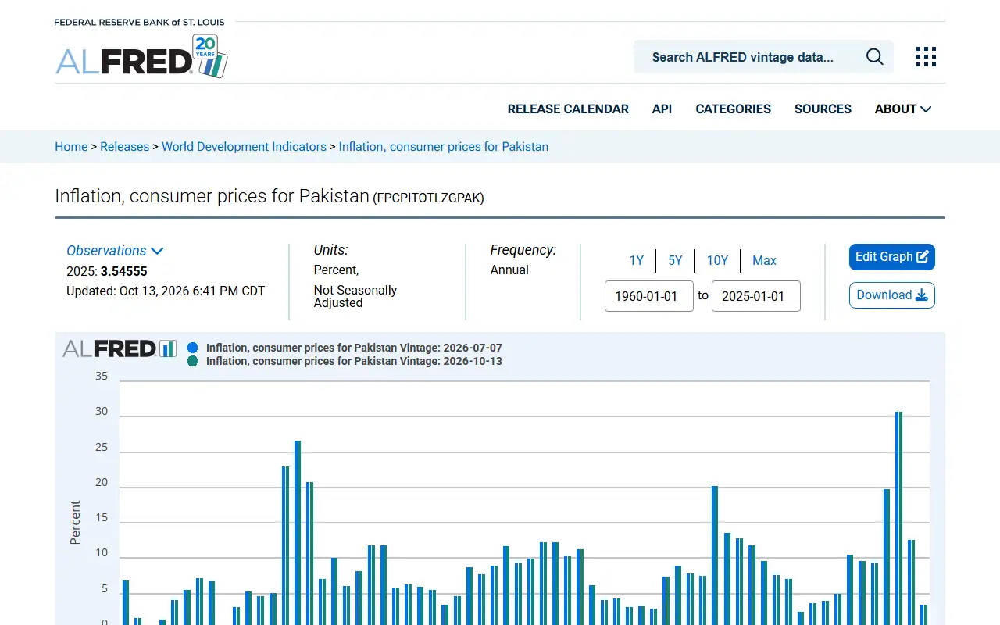 |

Real events break neat vocabularies. The 2025 US shutdown gave BLS a permanent gap and BEA two irregular vintages
("Initial" and "Updated" instead of advance, second and third). A version vocabulary must leave room for exceptions:
supplementary grants, provisional actuals, a missed edition.

### 2.6 Corrections are not revisions

ONS treats the two differently, and it works:

- **Routine revisions** are quiet and archived ("View previous versions", one click from every series).
- **Corrections** are loud and explained: a coloured bar directly under the title, dated, saying what was wrong,
  by how much, what was **not** affected, and "View superseded version". Because corrections are rare and
  prominent, people notice them.

PubMed's full-width "Retracted article" bar and Full Fact's dated correction note ("This fact check gave an incorrect
figure... The correct figure is...") are the same idea. Crossref's Crossmark adds the piece nobody in statistics has:
a "check for updates" link **embedded in the downloaded file**, so a reader holding an old copy can learn it was
corrected. The failure mode is a changelog page as the only place a correction appears: readers of the affected
figure never learn of it.

| ONS correction bar | PubMed retraction bar |
|---|---|
| 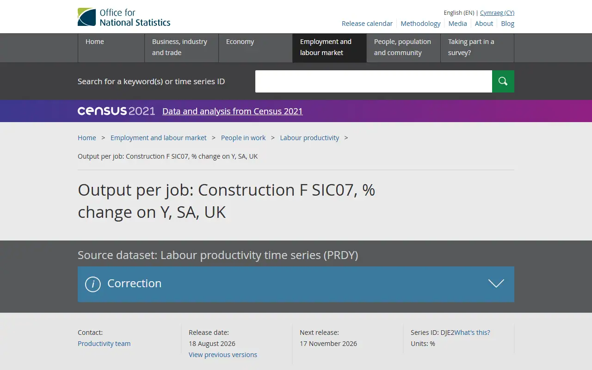 | 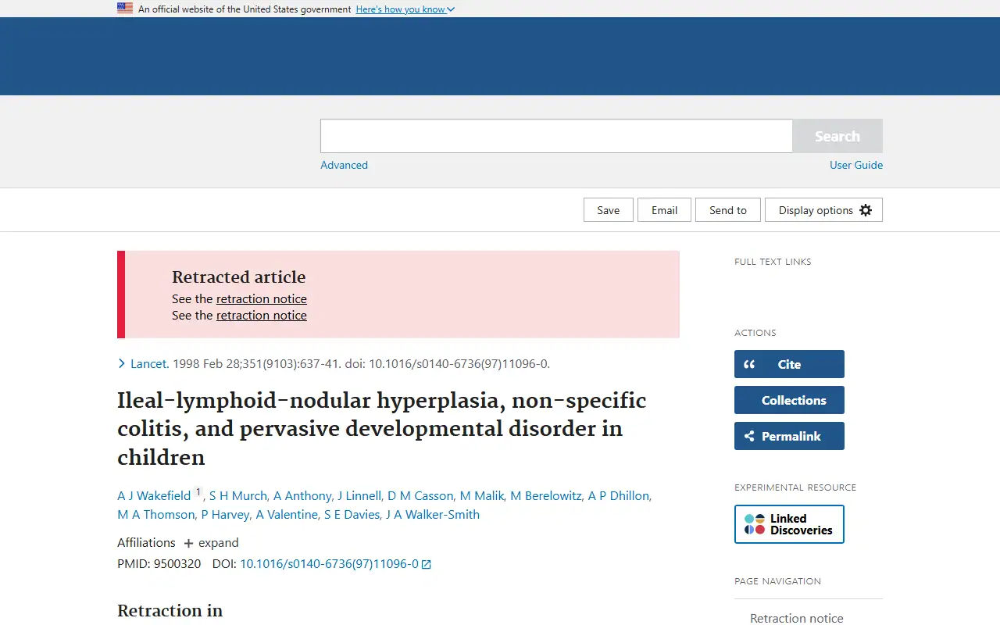 |

### 2.7 Search: curated concepts first, then forgiveness

The US Census Bureau's own research is the most useful evidence here. Its 2018 beta test found **only about 30% of
testers found the data they wanted**; search was the main failure, results depended on exact wording, and the
commonest remark was "I don't know what information the Census has". Eight years later, search for **place plus a
headline concept** is excellent (an instant answer with the margin of error), and search outside the curated set is
still word matching: "unemployment rate texas" returns housing coverage rates, "government health spending" is
silently turned into two filters that match nothing, "inflation" returns inflation-adjusted income tables with no
pointer to the agency that publishes inflation.

- **What the good ones do:** OWID is typo-tolerant, turns "Pakistan" in a query into a country chip, and shows each
  result as a chart card with the asked-for country highlighted and a Download button on the result, so finding is
  previewing. ONS and Census correct spelling ("Did you mean inflation?"). FRED shows trending searches as chips
  before you type. Eurostat puts a curated headline indicator first. SBP EasyData puts concrete official names in
  its placeholder.
- **What fails:** dead ends (Stats NZ's new explorer answers "No search result" for "CPI", the country's most-used
  statistic, without saying it lives in another tool); popularity-blind ranking (FRED and our site both rank a CPI
  index level above the inflation rate for "inflation"); silent filter chips; no "we don't publish this, here is who
  does".
- **Nobody shows the number itself in their own search results.** Google does it for FRED and World Bank data. With
  an index of about 16 KB compressed, we can.

| Census: silent chips, zero results | OWID: country chip, chart preview | ONS: "Did you mean" | Stats NZ: dead end for "CPI" |
|---|---|---|---|
| 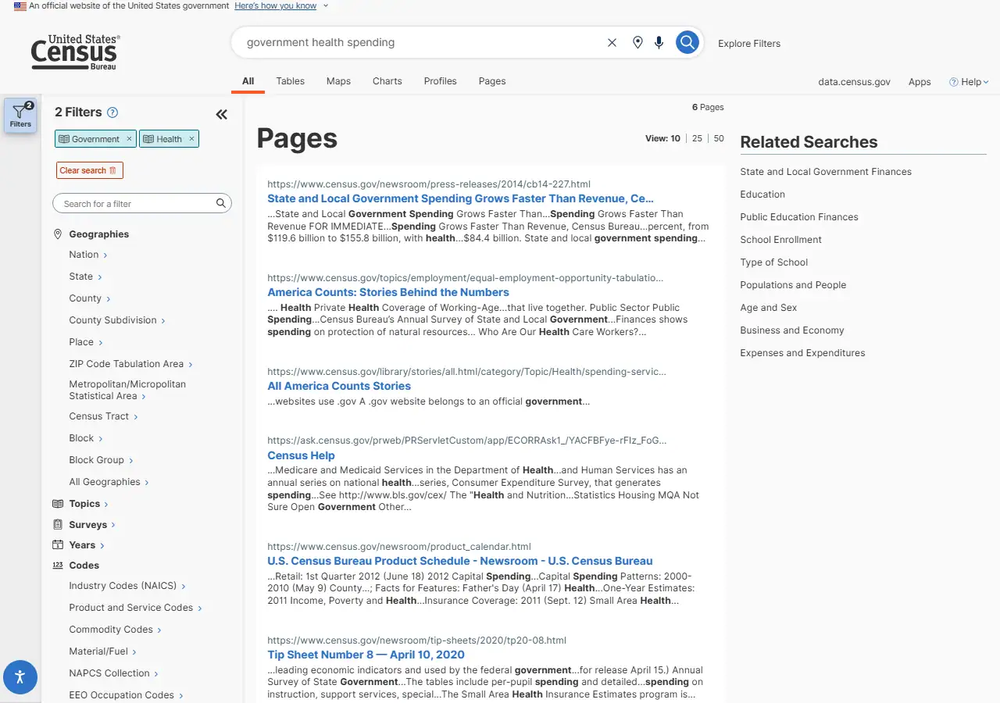 | 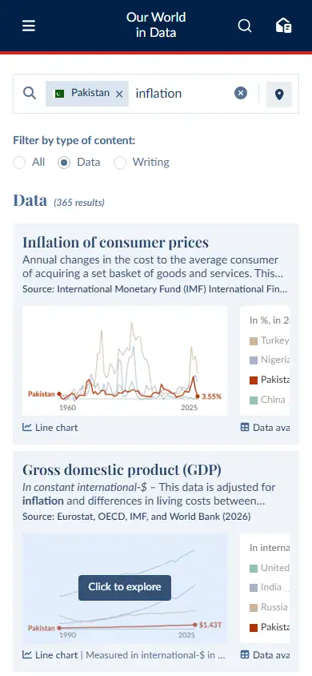 | 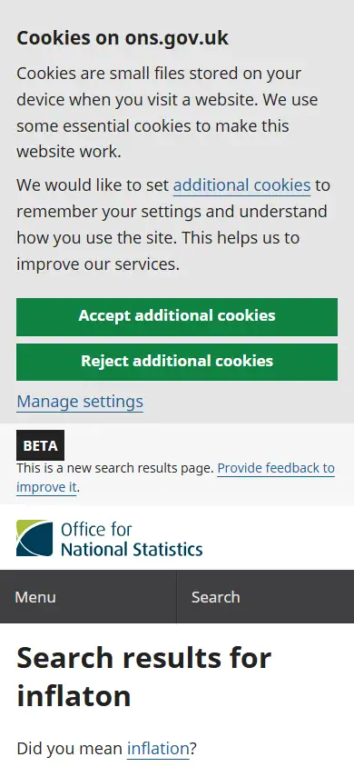 | 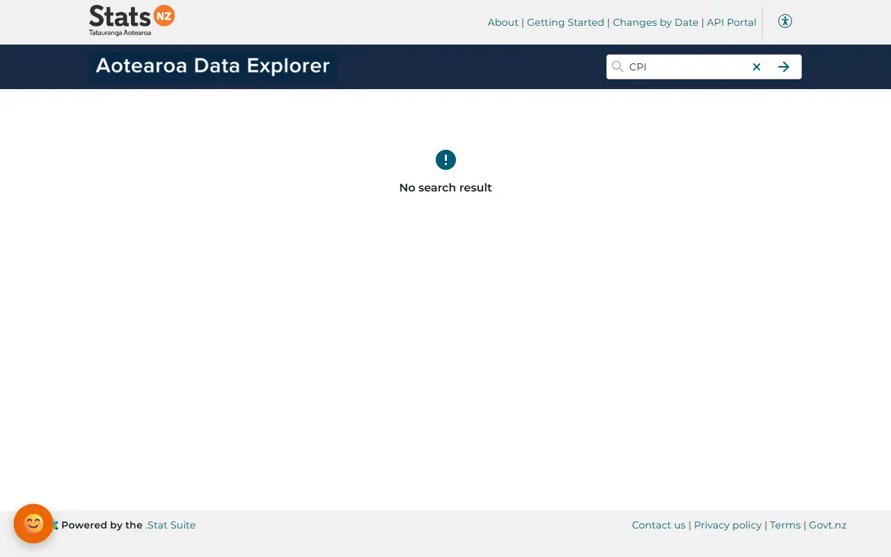 |

### 2.8 Draw a sensible default at once; let people change it in their own words

The tools learnable in under a minute (FRED's basics, IMF DataMapper, the World Bank indicator page, the ECB series
page, OWID's grapher) render a chart immediately and label their controls in the reader's words. The ones that are
not (OECD Data Explorer, World Bank DataBank, the IMF Data Explorer) make you configure before you see anything:
OECD asks you to pick one of eight chart types with names like "Timeline" before drawing; DataBank shows an empty
preview until three dimensions are chosen; the IMF explorer was still loading after 12 seconds.

- **FRED's "Units" control** is the single most useful idea for us. The first control in its Edit Graph drawer is a
  list of transforms: level, change, percent change, **percent change from a year ago**, index to 100 at a chosen
  date. The view is still "this series", the URL changes, and the download carries the transform. A teacher turns
  a CPI index into inflation in three clicks. It also solves mixed units in a comparison: put both series on a
  common basis instead of drawing a second axis.
- **IMF DataMapper** answers one question per page (one indicator, many countries, one year slider) with a URL a
  person can read and type (`/PCPIPCH@WEO/PAK/IND/BGD`), map, list and chart in sync, and projections drawn dotted.
- **Even OWID moved away from dense explorers**: its old Explorer URLs now redirect to a standard chart with one or
  two dropdowns above it.

| FRED: Units as transforms | OECD: choose a chart type before seeing anything | DataBank: empty until three choices | IMF DataMapper |
|---|---|---|---|
| 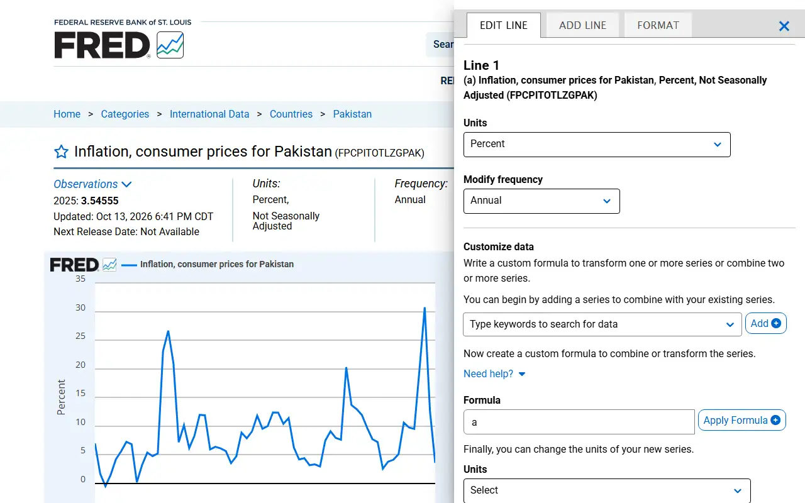 | 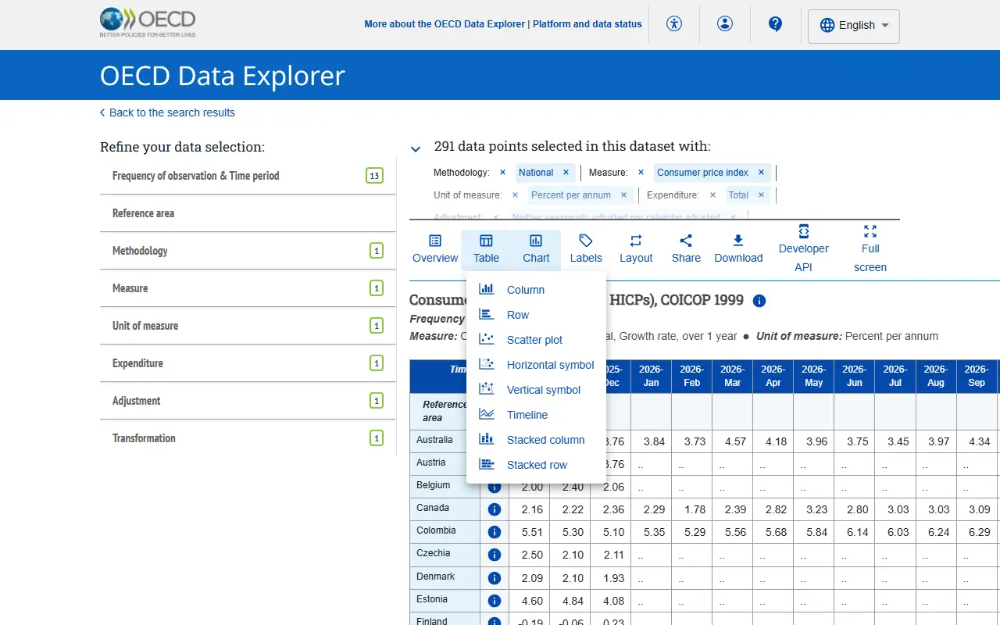 | 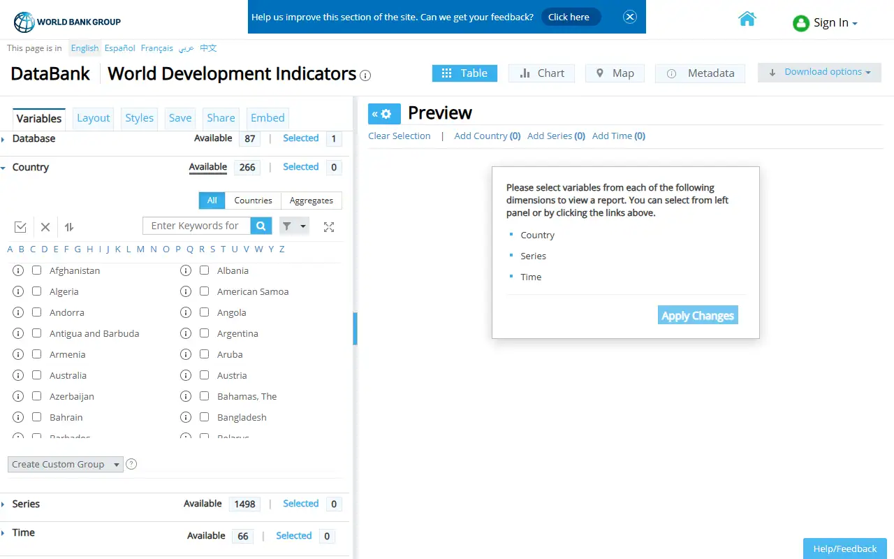 | 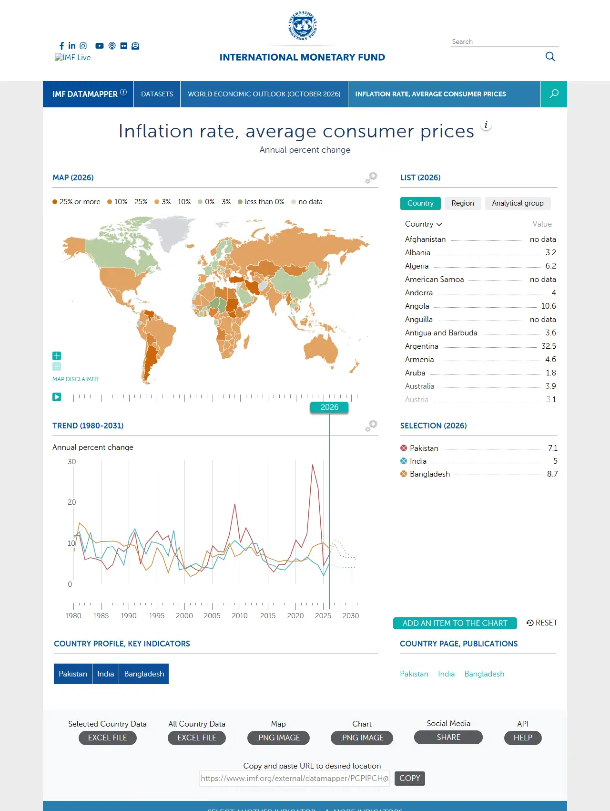 |

### 2.9 Downloads that say what they are

The best download dialogs answer, before you click: what is in the file, for what use, and how big it is.

- **Statistics Canada**: "Download as displayed (6.92 kB)", "excluding accompanying symbols", "symbols separate",
  "for database loading", the metadata (~50 kB), the entire table.
- **US Census**: three formats described by use ("Excel: presentation-ready", "CSV: table view", "ZIP: flat,
  machine-readable files including GEOIDs").
- **OWID**: "Download full data" (9,795 rows) or "Download displayed data" (66 rows), each a ZIP with a CSV, a
  metadata JSON and a README for people; API URLs with snippets for Excel, Python, R and Stata.
- **ABS Australia**: every table "Download XLSX [52.65 KB]" plus "Download all (1001.15 KB)".
- **Eurostat**: explicit scope (displayed dimensions, all selected, full dataset), flags in their own column, and the
  version and timestamp on every row, so the file explains itself.

The failures: a CSV that drops the caveat the page showed (USAFacts' "approximate" months), "Source: RBI" with no
document (Dataful), a sign-in before download, and file names nobody can cite (Bangladesh's statistics bureau uses
hashes like `2025-01-06-04-25-3a37...pdf`). On metered phone data, the size before the click matters.

| Statistics Canada download dialog | ABS: sizes on every file |
|---|---|
| 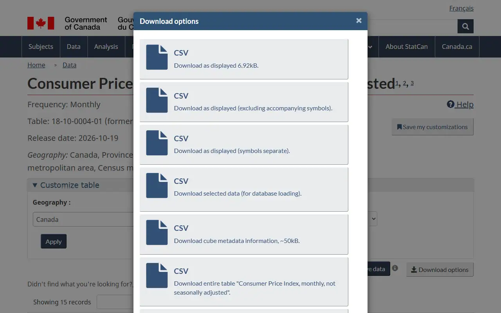 | 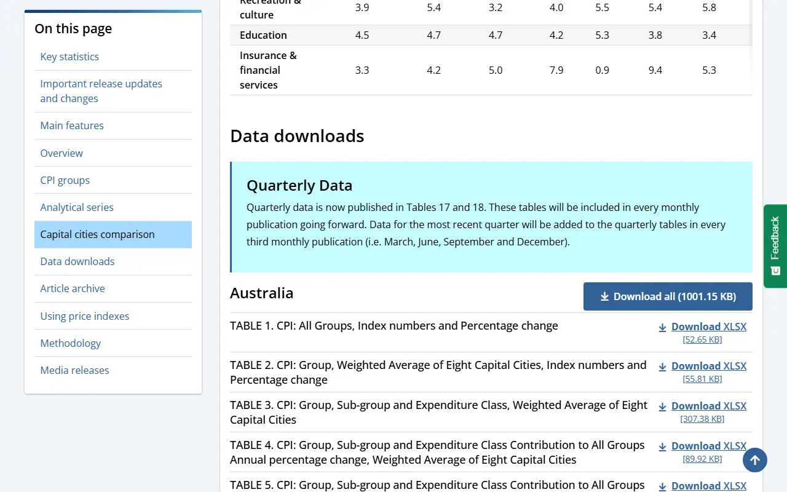 |

### 2.10 Citation: one sentence, publisher first, pinned to a version

Citation is weak almost everywhere.

- **FRED** gives one copyable sentence: the original publisher first, the title, the ID in brackets, "retrieved from
  FRED", the URL and the access date filled in. It is not versioned: it pins the day you looked, not the numbers you
  saw.
- **ABS Australia** has the best dialog: five styles (ABS, APA, MLA, Vancouver, Harvard), a Copy button each, access
  date filled in.
- **Statistics Canada** prints "How to cite" and a DOI under every table, no click needed, but neither carries a
  vintage, though values later gain "r" flags.
- **OWID** is the only one that versions it: the full citation ends with an **archived snapshot URL**
  (`archive.ourworldindata.org/<timestamp>/...`), and embeds can be "live" or "snapshot". OWID's teaching feedback
  found that teachers were unsure whether links were permanent enough to cite: **permanence must be stated on the
  page, not just true.**
- **Zenodo** states the cleanest model in one sentence: a version DOI that never changes meaning, and a concept DOI
  that "will always resolve to the latest one".
- **OECD** offers "snapshot of data" or "most up-to-date data" when sharing, the only versioned share in the economic
  tools, then demands an email address to give you the link.
- SBP EasyData added dataset- and series-level citations in May 2026, so Pakistani users now expect citation.

| ABS cite dialog | Zenodo: version and "cite all versions" | FRED's citation sentence on a phone |
|---|---|---|
| 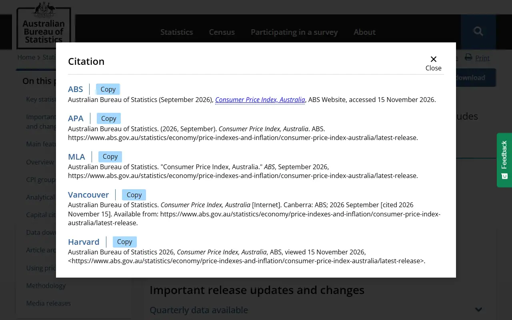 | 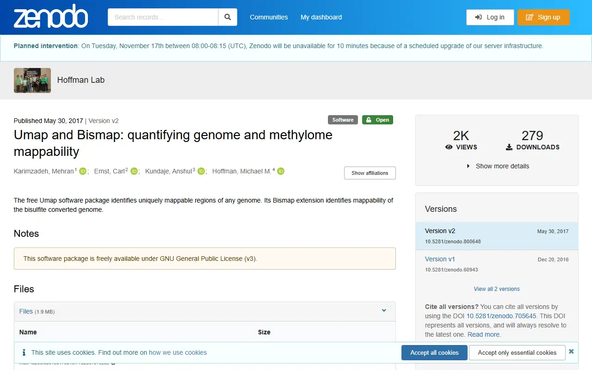 | 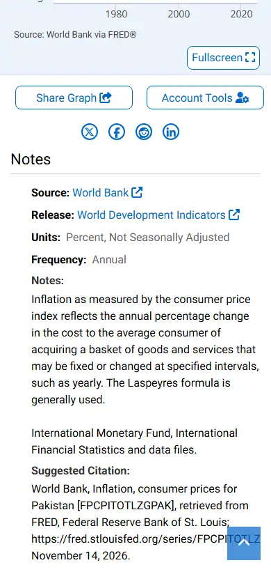 |

### 2.11 The simple layer is the mobile product

**None of the multi-dimensional data tools in the study works on a phone.** Eurostat's Data Browser says so in a
toast ("minimum 992 pixel width"); BEA's interactive tables and BLS series pages are desktop layouts; the .Stat
explorer used by ABS, OECD and Stats NZ scrolls sideways; Statistics Canada's table cuts off the latest month at the
right edge; the US Census table cuts off the value column. What works on phones, everywhere, is the simple layer:
Census QuickFacts and instant answers, BEA's GDP page, the Stats NZ indicator page, OWID's single chart, IMF
DataMapper's map/list/chart tabs.

Phone patterns that worked:

- **Touch tooltip as a bottom sheet** (OWID): tap the line and the value appears pinned to the bottom of the screen,
  not under your thumb. FRED's in-chart box sits under the thumb. Ours has no tooltip at all.
- **Tables:** a sticky label column (Census) or a table narrowed to what fits (OWID's three-column table). Newest
  period first or pinned, never off the right edge.
- **One view at a time** with segmented tabs (DataMapper: map | list | chart).
- **A sticky action bar** at the bottom (ours already has Download CSV / Cite / Compare; rare elsewhere).
- **Design at 360 px**: about a third of Pakistani phones are 360 px wide (StatCounter, October 2026).

| OWID tap tooltip: a sheet at the bottom | FRED: a box under the thumb | Ours: tapping does nothing |
|---|---|---|
| 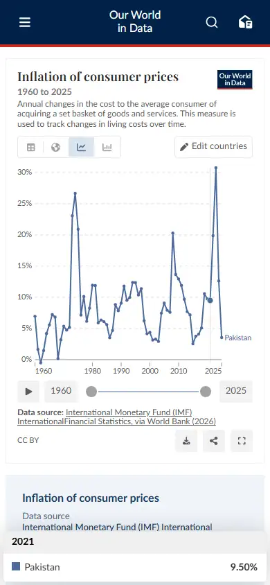 | 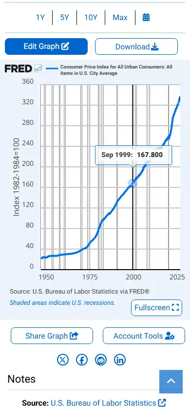 | 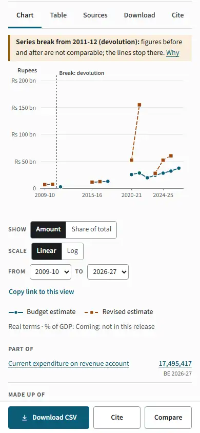 |

| Statistics Canada table: latest month cut off | Eurostat on a phone |
|---|---|
| 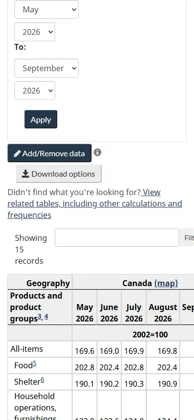 | 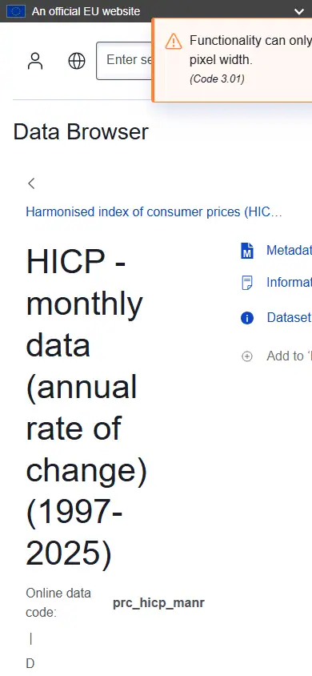 |

### 2.12 Provenance has to travel with the picture

Charts leave the site as screenshots, slides and WhatsApp forwards. OWID prints the source line, the note, the URL
and the licence **inside the chart frame**, so they are in every exported PNG and SVG. FRED puts its logo inside the
chart image. Visual Capitalist bakes the source and the IMF edition into its graphics, and still its 2026 inflation
map recirculates with the edition lost: three different Venezuela figures from three WEO editions, each shared as
"2026 inflation". The lesson is double: put the source, the kind of figure and the release in the image, and never
publish a headline that drops "projected" or "estimate".

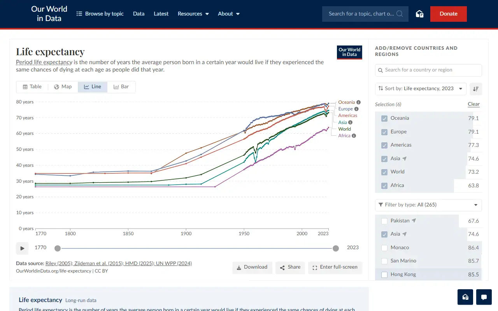

### 2.13 Breaks, retirements and the long life of a link

- **Breaks:** nobody in the study except us draws a classification break on the chart. The UK restates back series
  where it can and otherwise says plainly that figures are "not exactly comparable". The Sri Lankan central bank
  puts the base and the break in the legend label ("CCPI (2021=100), (Jan 2023 onwards)").
- **Retirements:** when the ECB discontinued its old inflation dataset in February 2026, it kept the old URLs alive
  with a dated notice and a link to the replacement. Eurostat froze its most-bookmarked inflation dataset at
  "1997-2025" with only the year range in the title to show it had stopped; an old bookmark lands on a normal-looking
  page that quietly ends.
- **Sustainability:** Open Budgets India, the nearest analogue to us (Union and state budgets, BE vs RE vs actuals),
  **now redirects to an online-casino site**; every explorer subdomain is dead, and links in papers and news send
  readers to gambling ads. OpenSpending and OpenBudgets.eu survive only as file catalogues; their interactive tools
  died when the grants ended. What lasted was open data files and a standard. Our receipts and permalinks are only
  as good as the domain and the archive behind them.

| ECB: a retired dataset pointing to its successor | Sri Lanka: base and break in the legend |
|---|---|
| 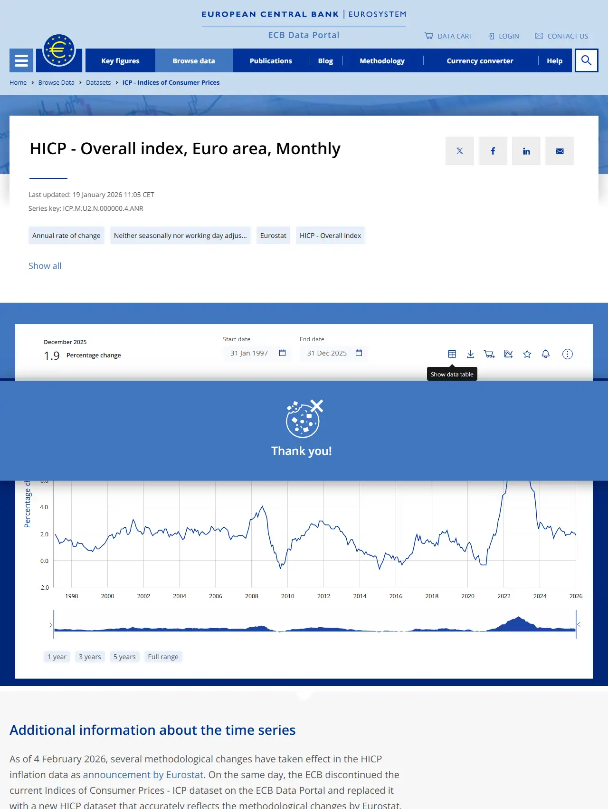 | 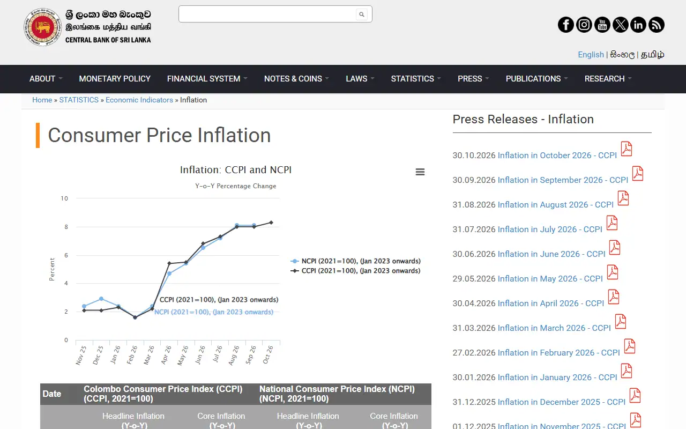 |

### 2.14 Things that destroy trust, especially here

From the regional study, things Pakistani users meet daily and resent:

- **Asking who you are to read public statistics.** PBS's price statistics page opens a "Subscription Form" asking
  for name, email, phone and **CNIC** with a reCAPTCHA; the PSLM portal asks for email and organisation; PBS's
  inflation decision-support system is a login wall; Karandaaz's metadata needs a login; SBP's comparison tool needs
  an account.
- **Weight:** Bangladesh's statistics bureau home page 21 MB, PBS home 17 MB, PBS inner pages 6 to 8 MB,
  vulekamali 9 to 12 MB.
- **Numbers only in PDFs**, often an Excel sheet printed to PDF.
- **Opaque or session-bound URLs** (SBP EasyData links carry a session id and checksum; PBS uploads all live under
  `2020/07/` whatever their date).
- **Dead or blocked links** (Finance Division's promoted Economy Dashboard returned a Cloudflare error; PBS's social
  portal returned 503; Indian government portals were unreachable from Pakistan).
- **Restrictive terms** (Karandaaz forbids redistribution and derivative works, which rules out teaching and
  journalism).
- **Forecasts drawn like facts** (Statista draws IMF projections to 2031 in the same style as outturns and writes
  "will rise" in its summary; its source is "imf.org").

| PBS: CNIC pop-up over the CPI page | Statista: forecasts drawn like outturns |
|---|---|
| 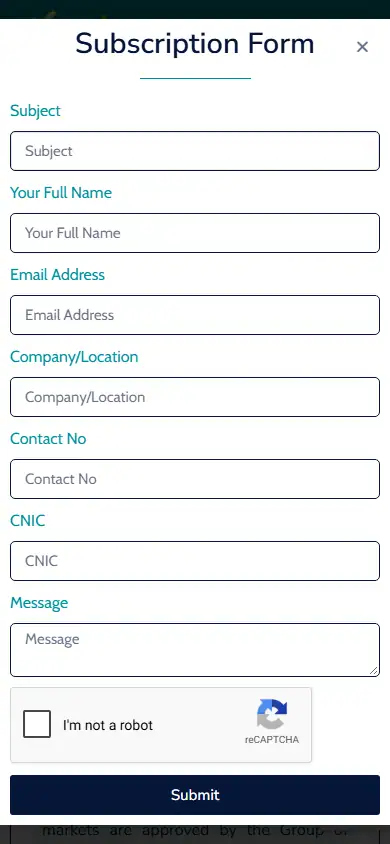 | 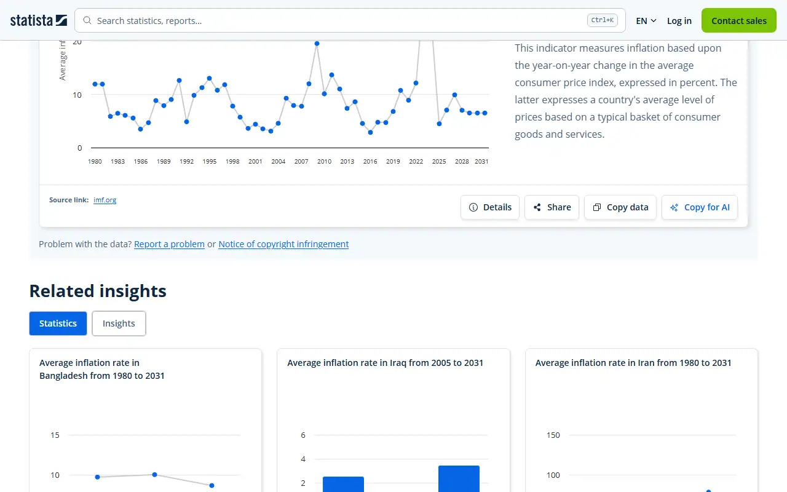 |

---

## 3. Site by site

Each entry: what it is and who it serves; what it does well and badly, with the reason; what it means for us.
"Phone" weights here are the quick first-screen measure; see [Measurements](#measurements) for careful ones.

### 3.1 Economic data tools

#### FRED (Federal Reserve Bank of St. Louis), fred.stlouisfed.org

About 800,000 series aggregated from other publishers, used by economists, journalists, teachers and students. The
closest model for us, and the default reference for a reason.

- **Task:** "Pakistan inflation, latest, chart ten years, download, cite": search "pakistan inflation", first result,
  10Y, Download CSV, scroll to the citation. About four clicks and a scroll, no friction.
- **Does well:**
  - The **fixed band above the chart**: latest period and value in bold, Updated, Next Release Date (linked to the
    release calendar), Units with seasonal adjustment, Frequency, 1Y/5Y/10Y/Max. Units are never more than a glance
    from the number, and a returning user's eye goes straight to the same place on every page.
  - The **ID next to the title** is the URL, the citation handle and the API key.
  - **Edit Graph** opens as a drawer over a live chart. Its first control, **Units**, turns any series into change,
    percent change, percent change from a year ago, or an index; **Add line** is one search box. Every change
    updates the URL. The order of processing (frequency, then units, then formula) is documented.
  - **Suggested citation** as one sentence with the original publisher first and the access date filled in.
  - Licence as a tag ("Public Domain: Citation Requested", "Copyrighted: Pre-approval Required").
- **Does badly:** values shown unrounded from the source feed (3.54555); Pakistan labelled by calendar year with no
  warning that Pakistani sources report July-June fiscal years (the World Bank and IMF do the same); revisions
  invisible unless you know ALFRED exists; the search index lagged its own series page by a year; about 2.2 MB on a
  phone, chart visible after 21 seconds on Fast 3G and 56 seconds at 400 kbps (a 692 KB charting bundle, tag
  managers, 155 KB of icon fonts).
- **For us:** copy the band, its fixed positions and "next edition expected"; copy Units as transforms (in the URL and
  in the download); copy the citation sentence and add what FRED lacks, the release version. Avoid unrounded values,
  hidden vintages and client-side chart weight.

| FRED on a phone | Edit Graph: Units | Add line |
|---|---|---|
| 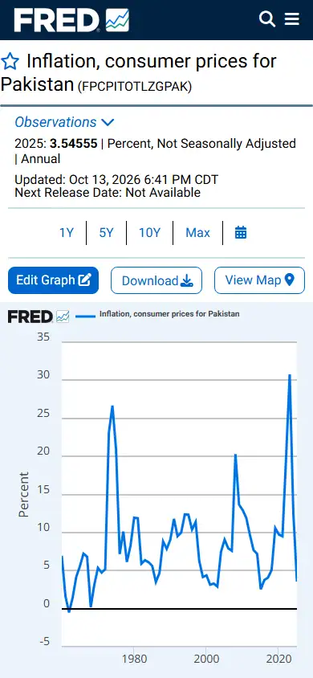 |  |  |

#### ALFRED, alfred.stlouisfed.org

FRED's archive of every past version of a series, with the same look and IDs.

- **Does well:** as-of dates as first-class objects; download formats "Initial Release Only" and "Real-Time Period"
  (each value with the dates it was current); **versioned metadata**, a table of each metadata field with the dates
  it was valid, which shows when a base year changed.
- **Does badly:** a separate site with no entry point on the FRED band; the default chart draws the two most recent
  vintages as paired bars from zero, so revisions are invisible; hundreds of vintage dates in a multi-select that is
  unusable on a phone; no citation text at all.
- **For us:** "as first printed / latest / every edition" as a view of the same series, on the series page; the
  download formats, renamed; dated definition changes. Never bars from zero for revisions: draw the change.

#### ECB Data Portal, data.ecb.europa.eu

- **Does well:**
  - The **series key decoded**: "Show all" opens a modal that turns each part of `HICP.M.U2.N.000000.4D0.ANR` into a
    plain name plus its code.
  - The **status word on the headline value**: "October 2026, Estimated value 4.0".
  - **Layers** in the catalogue: "Key data (418) / Detailed data (2534) / All data (90177)".
  - **Retiring a dataset properly**: the old inflation dataset's pages still work, with a dated notice and a link to
    the new one.
  - The lightest site in the group: about 200 KB on a phone, fully featured.
- **Does badly:** icon-only toolbars (table, cart, compare, alert) that need hover to explain themselves; a "Last
  updated" date on the discontinued series that looked current.
- **For us:** headline / detailed / everything layers in the catalogue, with candidates and held items in the outer
  layer; the decoded-ID modal; the retirement pattern for rebasings and reclassifications. Label our buttons.

| ECB: series key decoded | ECB: key / detailed / all layers |
|---|---|
|  |  |

#### OECD Data Explorer, data-explorer.oecd.org

A general SDMX table and chart builder over all OECD datasets (the .Stat Suite, also used by ABS and Stats NZ).

- **Does well:** the URL holds the whole view; a chip bar summarises the selection in words; filtered vs unfiltered
  downloads with metadata as its own file; the **snapshot vs live** choice when sharing.
- **Does badly:** not learnable in a minute (eight dimension panels; a menu of eight chart types before any chart);
  missing values as bare ".." with no reason; **an email address required** to get a share link, although the browser
  address already holds the state.
- **For us:** snapshot vs live for links ("this release: numbers frozen" vs "latest"); the selection summary in words.
  Never an empty state, never chart-type jargon, never a gate.

#### IMF DataMapper and IMF Data

- **DataMapper does well:** one question per page; a URL a person can read; map, list and chart synced to one year
  slider; **projections drawn dotted**; the WEO edition named in the header; on phones, map | list | chart tabs.
  People like it because there is nothing to build.
- **IMF Data (new portal):** each WEO edition is a frozen dataset with a version in the URL, listed on a "Dataset
  Vintages" page with an errata appendix per edition. It is 9 MB and its explorer was still loading after 12
  seconds.
- **For us:** readable URLs; dotted or hollow marks for figures that are not final; the edition named where the
  number is; vintages as versioned datasets with errata (our releases). Avoid heavy explorers.

| DataMapper chart on a phone | WEO vintages as cards |
|---|---|
|  |  |

#### World Bank: data.worldbank.org, Data360, DataBank

- **Does well:** search as removable chips ("Inflation, consumer prices" × "Pakistan"); **licence under the title**
  ("License: CC BY-4.0"); plain CSV / XML / Excel links; Data360's one-line metadata (range, economies, frequency).
- **Does badly:** no citation sentence anywhere; "Updated: 5 months ago" (a relative date cannot be cited); three
  products with different IDs for the same indicator; DataBank shows an empty preview until three dimensions are
  chosen; about 1 MB of ad and analytics tags on the indicator page.
- **For us:** chips for search; licence and source as one line each under the title; absolute dates.

### 3.2 National statistics offices

#### ONS (UK), ons.gov.uk

- **Does well:**
  - **Home-page cards** with measure, period, big number, change in percentage points, and two next steps (Analysis,
    Data): the best compact headline pattern in the study.
  - **"View previous versions"** one click from every series, every vintage downloadable at a stable URL.
  - **Corrections separated from revisions** (section 2.6).
  - **Download under every chart and table** in three formats, so users never work out which dataset a chart came
    from.
  - **Chart text rules** in its service manual: titles state the main trend in 15 words or fewer, the subtitle carries
    measure, geography and period in a fixed order, the source sits directly under the chart, footnotes stay short on
    mobile. **Uncertainty rule:** show it only when it changes the reading.
  - **No-JavaScript fallback:** a server-rendered chart image and all 643 observations as an HTML table.
  - Its own published lessons (ONS digital blog, February 2025): most readers read only the first two sections;
    putting headline figures first, nearly halving the words and writing for a lower reading age (US grade 12 to 8)
    improved the CPI bulletin. A 2018 change that split bulletins into task-based sections and collapsed breadcrumbs
    on phones brought 77% more release-day visits.
- **Does badly:** the legacy time-series page has no latest value in its text and an all-caps database label as its
  title ("CPIH ANNUAL RATE 00: ALL ITEMS 2015=100"); every one of 132 vintages labelled "Scheduled update/revision";
  citation only on bulletins, not on data pages; status labels on bulletins but not on series pages; search ranks a
  2022 article above the latest CPI bulletin for "inflation"; a cookie banner fills a first-visit phone screen.
- **For us:** the card; previous versions one click away but with specific reasons ("revised estimate 2025-26,
  printed in ABS 2026-27, p. 11") and the changed values shown; the correction bar; the chart-text rules.

| ONS series page on a phone: no number | ONS bulletin chart with download under it | ONS local statistics: a sentence headline |
|---|---|---|
|  |  |  |

#### Statistics Canada, statcan.gc.ca

- **Does well:** the published **symbol scheme with placement rules** (section 2.4); "How to cite" and a DOI under
  every table; the best download dialog in the study (sizes, symbol handling, metadata); **real-time tables** for 19
  key series, the full revision triangle in one table; The Daily as a predictable release format whose lead sentence
  states the number and its comparison. Its own 2025 study of 29 users is frank: search is the first stop and ranks
  data poorly; "historical comparisons and percentages often took several attempts"; it frames revisions as "a
  normal step in the statistical process", not errors.
- **Does badly:** a form-heavy table viewer (Apply buttons, a separate reload page to add or remove dimensions,
  113-entry year dropdowns) with no chart; the newest month off the right edge on a phone; the real-time tables are
  not linked from the normal table; the citation has no vintage; the headline sits in a carousel; a survey pop-up on
  the phone home page.
- **For us:** the symbol discipline, adapted to our statuses; file sizes before download; the revision triangle,
  linked from the series page; newest period visible on phones.

#### ABS (Australia), abs.gov.au

- **Does well:** the **Cite dialog** (five styles, copy buttons, access date filled in); file sizes on every download
  and "Download all"; **revisions told in words next to the number** ("up from a revised 3.5%", with the reason in the
  body); Previous and Future releases as two dropdowns in the header; Data Explorer views as URLs with the API one
  click away. Its 2020 redesign dropped PDFs for mobile and accessibility reasons and kept IDs and file names stable.
- **Does badly:** the hand-maintained "Key economic indicators" table goes stale silently (retail turnover still at
  June 2025 beside September 2026 rows), mixes number formats and is cut off before the value column on a phone; the
  release page has no number on the first phone screen.
- **For us:** the cite dialog; "up from a revised X", generated; never a hand-kept headline table.

| ABS key indicators on a phone: value column cut off |
|---|
|  |

#### Stats NZ: indicator pages and Aotearoa Data Explorer

- **Does well:** the **indicator page template**: Updated and Next update, one boxed headline number with its period
  in words ("September 2026 year"), a paragraph on what it is and why it matters, Graph | Table, the latest releases,
  where to get more. It answers the lay question in one phone screen and gives experts the routes onward.
- **Does badly:** fragmentation (indicator page, then Infoshare for the time series, then the new explorer for census
  data); the new explorer's search finds nothing for "CPI", "price" or "inflation" and does not say where to look;
  the explorer is not responsive and takes about 20 seconds to a table.
- **For us:** the template order for the phone series page, including the "why it matters" line we lack; never send
  people to another tool for the long series or the download.

#### US Census Bureau: data.census.gov and QuickFacts

- **Does well:** **instant answers** for place plus headline concept, with the margin of error and the survey in the
  sentence; citations whose URL pins the vintage, geography and filters, in six styles; downloads described by use;
  **QuickFacts**: a two-column list of plain-language facts with the vintage inside the label, a definition button
  per row, and a warning triangle in the value cell; missing values explained in place of the number.
- **Does badly:** word matching outside the curated concepts; silent filter chips that combine to zero results; no
  "we don't publish this; try BLS"; a 5.9 MB landing page whose first screen only demonstrates search; phone tables
  with the value column cut off.
- **For us:** an answer card for our top concepts; a hand-written list of the hundred concepts people actually ask
  for; inferred filters always shown and removable with "search everything instead"; a "who publishes this" result.

| QuickFacts | Census download dialog |
|---|---|
|  |  |

#### Eurostat, ec.europa.eu/eurostat

- **Does well:** flags in the cell with a legend that lists only the flags in view; flags as a separate column in long
  CSV, with the dataset version and last update on every row; a DOI per dataset in the header with a copy button;
  explicit download scope; a "first published data" dataset kept beside the revised one; Statistics Explained prints
  "Planned article update: 18 November 2026".
- **Does badly:** the Data Browser refuses phones; the default view is index levels for 46 countries, not the annual
  rate everyone wants; no number on the desktop first screen; pop-up toasts with internal codes; the chart does not
  show that its last point is a flash estimate; the DOI always resolves to the current version, and old versions can
  be proven by hash but not downloaded; a classification change froze the most-bookmarked dataset with no banner.
- **For us:** the flag legend and file design; "next update expected"; old releases downloadable (we freeze them
  anyway); a banner on any series that stops.

#### BLS, bls.gov

- **Does well:** the series ID is the permalink and every view rebuilds from the URL; **flags decoded in the table's
  last row with the reason**; **gaps carried into derived values**; "Data extracted on" with a timestamp on every
  view; published **revision statistics** (first to third estimate, mean and mean absolute revision since 1979); light
  pages (about 600 KB); Top Picks, a checklist of the most-used series in plain words.
- **Does badly:** not responsive (giant checkboxes and a GO button on a phone, no data on the first screen); a bot
  wall on www.bls.gov and a CAPTCHA on keyword search, which also block teachers' scripts and screen-reader tools; a
  static chart image; no citation text.
- **For us:** the flag line with reasons; carry holds into derived figures; a "how much do budget estimates change?"
  panel from our nine editions; never a CAPTCHA.

| BLS: "(P)" in the cell, decoded in the last row | BLS series page on a phone |
|---|---|
|  |  |

#### BEA, bea.gov

- **Does well:** the vintage next to the number on the headline page ("Q3 2026 (Adv) +3.4%"); current and next release
  dates side by side; **an archive indexed by period, vintage and release date**; a suggested citation printed under
  every table; revision statistics.
- **Does badly:** the interactive tables drop the vintage label (an advance and a third estimate look the same); the
  archive is a list of Excel files with no "this cell across vintages" view; interactive tables not responsive;
  navigation by table number.
- **For us:** a vintage tag beside every number everywhere, not only on the headline page; a "versions of this
  figure" table; an extensible vocabulary of figure kinds.

| BEA vintage archive | BEA interactive table: no vintage label |
|---|---|
|  |  |

### 3.3 Explainers

#### Our World in Data, ourworldindata.org

A non-profit that republishes about 14,000 charts built from other people's data, with its own writing. A
republisher like us, so its patterns carry over almost directly.

- **Teacher test:** on a phone, search "inflation pakistan": Pakistan becomes a country chip and the first result's
  preview already highlights Pakistan's line (3.55%). Two taps plus typing, 15 to 20 seconds; the chart fills the
  first screen; full-screen for a projector; "Copy chart as image" for slides. It passes.
- **Does well:**
  - **The chart is the page.** Title, a one-sentence subtitle that defines the measure, and inside the chart frame a
    "Data source" line and a "Note" carrying the most important caveat. Everything else is one tap away, and each tap
    has its own URL.
  - **Sources overlay** (`?overlay=sources`): source, Last updated, **Next expected update**, date range, unit, then
    the producer's own description and "how we process data".
  - **The download** (section 2.9) and **versioned citation** (section 2.10).
  - **Search** that previews answers: chart cards with the asked-for country highlighted and a Download button on the
    result.
  - **A named person** ("Managed by") on each data page.
  - Its own lessons: a single search because users should not need to know where to look first; metadata shipped with
    the data because context prevents misreading; "overview first, zoom and filter, details on demand".
- **Does badly:** a cookie banner over half the phone screen; substituted years ("closest year shown instead")
  disclosed in the note but not marked on the map; no vintage view although it keeps archives; long, repetitive data
  pages on a phone; about 2 MB and a chart after 17 seconds on Fast 3G (one 1 MB bundle).
- **For us:** source and key caveat inside the chart and its exports; overlays with their own URLs; the download
  modal; archived, release-pinned citation URLs; "next expected update". Mark substituted, held or estimated points on
  the chart itself.

| OWID chart on a phone | OWID download | OWID search cards |
|---|---|---|
|  |  |  |

#### Gapminder, gapminder.org

- **Does well:** one picture with a built-in question ("where is my country?"), animated through time, with a
  presentation mode for classrooms; an orange **"Data doubts"** link inside the chart opens a frank, plain caveat;
  Dollar Street turns an income into photographs of homes.
- **Does badly:** exact values need hover, which phones and projectors do not have; the caveat is generic, the same
  for every indicator; the URL state is unreadable.
- **For us:** an in-chart caveat link written plainly ("Budget estimate, not actual spending"); a present mode; later,
  a provinces bubble chart from survey data. Never hide exact values behind hover.

#### USAFacts, usafacts.org

- **Does well:** the page title is the question and the first sentence is the answer with its date; **chart titles
  state the takeaway and subtitles give the technical definition**, which is how it serves citizens without dumbing
  down for experts; "Source: Bureau of Labor Statistics →" under every number opens a drawer that also credits
  "processing by USAFacts"; navigation by questions, each tagged with its update cadence; a missing government month
  disclosed in the text and again on the chart.
- **Does badly:** hero art pushes the answer down (on desktop the first screen is all illustration); revised figures
  are replaced silently; no citation; the downloaded CSV loses the "approximate" caveat; it interpolated a month the
  government never published (disclosed, but mixed into the official series); 1.5 MB.
- **For us:** question-titled answer pages for the top citizen questions; claim title plus technical subtitle;
  "Source →" under every number opening the receipt as a drawer; update cadence on every entry.

#### Ember (energy think tank), ember-energy.org

- **Does well:** a per-country, per-series note under the chart: "Data notes: Pakistan – Solar generation is estimated
  from 2019 to account for underreported rooftop solar"; an opening sentence with a comparison ("55%... above the
  global average of 43%").
- **Does badly:** the estimated years are not drawn differently; on a phone the explorer's whole first screen is
  controls, with no chart.
- **For us:** "Data notes: <series> – <note>" generated from series notes; chart first, controls in a sheet.

| Ember: data notes under the chart | Ember on a phone: controls, no chart |
|---|---|
|  |  |

#### Dataful (Factly, India), dataful.in

India's nearest analogue to us: 18,000 cleaned datasets from government sources.

- **Does well:** collections ("Inflation indicators"); rows, columns and period beside the download button; CSV, XLSX
  and Parquet; a citation tab.
- **Does badly:** blank values with no reason; the source given as "Reserve Bank of India" with no document, table or
  page; a citation that is not tied to a version; downloads possibly behind a sign-in.
- **For us:** this is exactly the gap our receipts and labelled gaps fill. Say so plainly.

#### Statista and Visual Capitalist: to learn from critically

- **Statista** titles a page "Average inflation rate in Pakistan from 1980 to 2031", draws the IMF projections to
  2031 exactly like the outturns, writes "will rise" in a generated summary, gives the source as "imf.org" and its
  author as "Statista Research Department", and covers the phone screen with a consent dialog "with 868 partners".
- **Visual Capitalist** headlines a projection without the word "projected"; its graphics are tall images with tiny
  type that are unreadable on a phone; pages weigh 4.6 to 7.3 MB; and its graphics recirculate with the edition lost.
- **For us:** never draw estimates, projections or budget figures like outturns; never drop "budget estimate" from a
  headline; a source is a document, an edition and a page, never a domain.

### 3.4 Budget and fiscal transparency

#### USAspending.gov

- **Does well:** a drill **trail that keeps the total at every level** (All budget functions $10.1T > Health $1.2T >
  Health care services $1.1T), each step clickable; "% of total federal budget" as the default framing; obligations
  vs outlays defined in one paragraph beside the chart ("three stages of the same money"); unreported money shown as
  a named block; a **public per-agency data-quality table** (`/submission-statistics`).
- **Does badly:** one year at a time with no trend; treemap labels truncated ("Un...", "Tr..."); a "rotate your device"
  toast on phones; heavy (about 3 MB home page on a phone).
- **For us:** a trail with totals on the series page; a public quality table per source document; a one-paragraph
  explainer of the stages of a budget figure beside the chart. Sorted bars, not treemaps, on phones.

| Drill trail with totals | Public data-quality table |
|---|---|
|  |  |

#### Fiscal Data (US Treasury), fiscaldata.treasury.gov

- **Does well:** a row of **pills** under each dataset title (date range, cadence, last updated, **"New Data Expected
  12/10/2026"**, number of tables); the original PDF reports one click away; "Notes & Known Limitations" as a standard
  tab, including a note that explains why six Treasury datasets give six different debt totals without picking a
  winner (support for our "disputed"); the citizen explainer labels its treatment in the chart subtitle ("Inflation
  Adjusted - 2026 Dollars") with an Amount | % of GDP toggle and the GDP and deflator sources under the chart.
- **Does badly:** 4 to 6 MB pages; raw IDs as the first columns of previews; no per-person framing; no citation.
- **For us:** the pill row; a known-limitations tab per data type; the unit treatment stated in the chart subtitle.

| Fiscal Data pills | Real terms stated in the subtitle | Known limitations |
|---|---|---|
|  |  |  |

#### vulekamali (South Africa National Treasury), vulekamali.gov.za

The best model in the study for budget phases (section 2.5): a page organised by the budget cycle (Plan, Implement,
Review), a phase legend per year, adjustment cards that show the change, glossary popups on the terms in the
explanatory sentence. Also the most instructive failures: inconsistent phase labels, figures on one page that
disagree with no visible check, links to whole documents never to a page, mislabelled downloads, and a department
page that is 11.7 MB and not responsive on a phone.

#### GC InfoBase (Treasury Board of Canada)

Per-panel download, share and details icons; a floating glossary button. On a phone, the whole first screen is orange
banners naming exactly which bodies' data are not yet available: honest and specific, and it buries the product. A
single-page app that took about 30 seconds to show anything on an emulated phone. Its firewall blocked further
visits.

#### Open Budgets India, OpenSpending, OpenBudgets.eu: what lasted

- **Open Budgets India** (CBGA and CivicDataLab) held about 16,000 budget PDFs and explorers whose stated aim was to
  show citizens the gap between promises (budget and revised estimates) and realisations (actuals). It rebuilt its
  Union Budget Explorer as a separate site for each year, which made year-to-year comparison impossible. Its sector
  dashboard had a BE / RE / Actuals switch and per-capita and share-of-budget indicators. **Today its domain
  redirects to an online casino** and every explorer is dead. Not seen live; described from archived text and its
  GitHub repositories.
- **OpenSpending** is now a file catalogue; **OpenBudgets.eu**'s home page is frozen at October 2017 and its apps do
  not respond. The open files and the Fiscal Data Package standard outlived the money; the interactive layers did
  not.
- **For us:** a written plan for the domain and a static mirror; releases deposited with DOIs; a site that still works
  served as plain files; one series across editions, never one app per year.

#### Pakistan Finance Division, finance.gov.pk (as the upstream for budgets)

A plain list of PDFs per budget year (Budget in Brief, Annual Budget Statement, Demands for Grants, Supplementary and
Excess Grants, Urdu versions), no data files, no explanations, not responsive. The **Fiscal Operations** page lists
consolidated actuals by year with the newest marked "(Provisional)": the third and fourth phases after BE and RE, and
the natural next source. Supplementary and excess grants are the documentary bridge between a budget estimate and
what was spent; linking the health jump to a supplementary grant would be strong evidence.

#### UK HM Treasury PESA (text only)

Explicit labelling ("Real terms figures are values that have been adjusted for inflation"; "adjusted to 2024-25
prices"); per-head tables and an index (UK = 100); a release note giving the headline revision as two numbers and a
reason; back series **restated** where possible, and otherwise a plain "not exactly comparable". That distinction,
restated versus a break, is one we will need once provincial budgets arrive.

### 3.5 South Asia

#### Pakistan Bureau of Statistics, pbs.gov.pk

The office most people try first. **Monthly CPI inflation for five years, on a phone:** about six taps; close a
pop-up that asks for a CNIC; scroll about six screens past prose to a sidebar; open an eight-page PDF that is an Excel
sheet printed out (ending June 2026); then four Monthly Review PDFs for July to October; then retype about 64
numbers. About 26 MB before a usable series. Search finds blog posts, not series. The monthly report page has no
number in its HTML, only four attachment links. A machine-readable SDMX file of the CPI exists at `pbs.gov.pk/cpi`
(made for the IMF's data standards) and is not linked from any page a person would find.

- **Does well:** publishes fast and keeps long archives; LFS microdata downloadable without registration, with the
  questionnaires; the historical series sheet shows PBS knows users want a series.
- **For us:** use the names users know ("Monthly Review on Price Indices", "CPI National", "base 2015-16") as search
  synonyms and on receipts; link the exact PBS PDF and our archived copy (PBS's upload URLs are unstable, so the
  archive matters more here than anywhere); be the place where the series is continuous across the historical sheet
  and the monthly reviews.

| PBS price statistics on a phone | PBS monthly report: links, no number |
|---|---|
|  |  |

#### State Bank of Pakistan: EasyData, easydata.sbp.org.pk

The best official data tool in Pakistan, and the closest thing to FRED in the region: series as the unit, search with
concrete examples in the placeholder ("Policy Rate, Exchange Rate, Currency in Circulation"), "Most viewed (last 7
days)" and "Recently released" lists as entry points, wide and long downloads with date ranges, dataset- and
series-level citations (since May 2026), an API with a key. Weak points: **links carry a session id and checksum**,
so they cannot be shared or cited reliably; Cloudflare blocked every page past the home page for our tools; comparison
needs a login; slow to settle (34 seconds) though light (113 KB). For us: copy the entry lists and the placeholder;
link to EasyData series keys from related series rather than duplicating SBP data; never put state in a session.

#### Finance Division: Budget and Economic Survey (as users meet it)

Fixed-width pages shrunk to unreadable on a phone; every row a PDF; the complete Economic Survey is a 54.8 MB volume
(chapters are separate, which helps). **Federal health spending** today: open the Economic Survey Health chapter (22
pages, 1.5 MB), go to Table 11.5 on page 5 (Rs million, federal and provincial, six years, one marked provisional); or
open one 2.3 MB Annual Budget Statement per year and read three columns each. Users cite "PES 2025-26, Table 11.5",
so document plus table plus page will feel natural.

#### Bangladesh and Sri Lanka

- **Bangladesh Bureau of Statistics:** a 21 MB home page in the national portal template, a notice board of circulars,
  monthly releases as PDF and Excel with hash file names. One neat touch: a ticker that carries "(2025-26p, Q3)",
  provisional inline.
- **Bangladesh Bank Open Data Initiative:** the whole *Monthly Economic Trends* publication as **one Excel file updated
  monthly**, plus history back to 1972, with the update cadence beside each file. A "whole release as one file"
  download is worth copying.
- **Central Bank of Sri Lanka inflation page:** the best single page in the regional group: a twelve-month chart, an
  HTML table under it, dated press-release PDFs beside it, base and break in the legend. Its Data Library is a
  three-step wizard that is not responsive.

| Bangladesh Bank: the whole publication as one Excel | BBS home on a phone |
|---|---|
|  |  |

#### India

**Unreachable from Pakistan.** MoSPI, data.gov.in and RBI's data portal timed out, failed DNS or returned "Access
Denied" both from here and to WebFetch, which is itself a finding: Indian portals are not what Pakistani users know.
The screenshots below are of **Wayback Machine copies** (November 2026 for eSankhyiki), loaded in the same headless
browser; their load times mean nothing. RBI's DBIE was not seen at all (its archived copies render blank) and is
described from secondary sources only.

- **MoSPI eSankhyiki** (launched 2024): a data catalogue and "macro indicators" with Table, Chart, API and Metadata
  tabs. Its national accounts table carries the **revision stage as a plain-word column and filter**: "Provisional
  Estimates / First Revised Estimates / Final Estimates", next to base year and series (current or back series). The
  official API carries the same revision code. This is the clearest stage labelling in the region, yet there is no
  view of how one figure changed between stages. On a 390 px phone the table shows four of its twelve columns, so the
  stage and the value are off-screen. Home-page tiles carry a bare asterisk with no visible explanation; a catalogue
  card for industrial production was labelled "Consumer Price Index"; no citation text was seen.
- **data.gov.in**: CSV, XLS, XML, JSON and ODS for each resource, but **every download opens a "Download purpose" form
  with a CAPTCHA**; each update is a separate file ("upto January 2024"), so the CPI series there stops in January 2024;
  most metadata fields read "NA"; the API needs a key from a registered account.
- **India Budget** (indiabudget.gov.in): each budget statement as a PDF plus an XLSX of the same table, with a banner:
  in case of inconsistency, the English PDF is final. Governments themselves treat the printed document as the
  authority, which is our receipt model.
- **RBI** (secondary sources): DBIE moved to `data.rbi.org.in` in 2024 and a separate mobile app (2025) offers
  thousands of series with charts and downloads.
- **What looks normal to South Asian users:** BE, RE and Actuals, and advance, provisional and revised estimates, in
  plain words; Excel first; the PDF as the authority; a separate app for phones; and, increasingly, AI search buttons
  floating over the content.

| eSankhyiki: revision stage as a filter and a column | eSankhyiki table on a phone | data.gov.in: a form and CAPTCHA before every download | India Budget: "the English PDF is final" |
|---|---|---|---|
|  |  |  |  |

#### Pakistani independents

- **Karandaaz Data Portal:** the most FRED-like Pakistani site: chart, then a card with period, range and source, then
  CSV and XLSX; 416 KB on a phone with the chart on the first screen. Proof that this layout works on Pakistani phones.
  But metadata is behind a login, the source is an agency name with no page or edition, and its terms forbid
  redistribution and derivative works.
- **Open Data Pakistan** (CKAN): a file locker of uneven freshness where provenance is "who uploaded it". LUMS's
  CHISEL lab already publishes there.
- What many users actually do is search Google and land on an aggregator such as Trading Economics, with no source page.

### 3.6 Evidence and versioning outside statistics

- **Wikipedia:** a tiny `[10]` costs nothing at a glance; on desktop a hover card, on a phone a **bottom sheet** that
  keeps your place. The right delivery for our source markers. History and diff (old left, new right, changed words
  highlighted) are universally understood.
- **FEC** (US election filings): every transaction row expands to "Open image", the filed page it came from, and a
  "Processed | Raw" toggle explains in a sentence how long processing takes. The nearest public precedent to our
  receipt, without the box around the figure.
- **ProPublica Nonprofit Explorer:** parsed figures for each year sit beside "View Filing" for that year, at the same
  visual weight, with "See an issue with the data? Contact us" beside them.
- **Full Fact:** a "What was claimed / Our verdict" box above the evidence; on a phone the verdict is the first screen.
  Our status line should behave like their verdict.
- **Legal research** (CourtListener, Westlaw, Google Scholar): star pagination, page markers in the margin of a text so
  a quote can be cited to its printed page.
- **DocumentCloud:** reporters draw a box on a page and attach a public note with its own URL; coordinates stored as
  fractions of the page, as ours are.
- **Commercial document-AI review tools** (LandingAI, Pulse, LlamaParse) all now store a page and bounding box for
  every extracted value and draw a highlight for reviewers, inside their products. Doing it in public, for every
  published figure, is still unusual.
- **PDF deep links:** `#page=17` works in PDF.js, Chrome and Acrobat; highlight parameters are ignored by browsers, so
  the image crop is the only cross-browser way to show the cell.
- **Zenodo and Harvard Dataverse:** the version in the citation itself ("Harvard Dataverse, V10"); a versions table
  with a generated change summary and "View differences"; Zenodo's version vs concept DOI.
- **DoltHub:** click a cell and see its history (from-value, to-value, commit, date). The right granularity for
  "history of this figure".
- **Crossref Crossmark:** "check for updates" travels inside downloaded files.

| FEC: "Open image" for a filed row | Full Fact verdict on a phone | Dataverse versions |
|---|---|---|
|  |  |  |

---

## Measurements

Phone emulation (390×844, Android Chrome user agent, 4× CPU slowdown) with real wire bytes from the browser's
network log. "Fast 3G" here is 1.6 Mbps down, 150 ms round trip; "slow" is 400 kbps, 400 ms. Single runs, cold cache,
measured 14 and 15 November 2026 from Pakistan.

| Page | KB transferred | JS KB | Font KB | Number or chart visible, Fast 3G | ... at 400 kbps |
|---|---|---|---|---|---|
| **LUMS series page** | 381 (758 after 30 s) | 161 | 148 | 1.4 s | 3.0 s |
| **LUMS home** | 330 (**2,005** after 30 s) | 142 | 148 | 1.5 s | 3.1 s |
| **LUMS receipt** | 751 | 154 | 148 | 1.9 s | 3.1 s (page image 15.9 s) |
| **LUMS catalogue** | 593 (5.3 MB uncompressed) | 145 | 148 | 1.6 s (load 9.0 s) | 2.9 s |
| **LUMS compare** | 511 | 154 | 148 | 1.5 s | 2.9 s |
| ONS time series | 309 | 190 | 36 | 11.8 s | 10.1 s |
| USAFacts answer | 1,619 | 1,382 | 137 | 1.6 s | 3.6 s |
| IMF DataMapper | 1,718 | 732 | 572 | about 25 s | about 37 s |
| OWID chart | 2,070 | 1,346 | 232 | 17.4 s | 44.7 s |
| FRED series | 2,225 | 1,678 | 387 | 21.3 s | 56.1 s |
| data.census.gov table | 2,240 | 1,668 | 181 | 22.7 s | 43.0 s |
| World Bank indicator | 2,386 | 1,981 | 121 | 20.7 s | 37.2 s |
| PBS price statistics | 6,508 | 3,353 | 479 | 34.6 s | 101.8 s |
| *lite.cnn.com (reference)* | 35 | 0 | 0 | | 2.1 s |

What dominates the peers' weight, in the same three ways everywhere: one large client-side chart or application
bundle (0.7 to 1.7 MB), tag managers and bot-protection scripts (0.3 to 1 MB), and icon fonts (155 to 572 KB). None of
it is needed to show one number and one line.

Why ours grows after load: the framework prefetches the pages behind links as they scroll into view, and receipt
pages carry hints that pull whole printed-page PNGs (157 to 440 KB each). Nobody chose this; it is a default. The
receipt crops its magnified view from a whole-page PNG; a pre-cut crop would be 15 to 30 KB. The catalogue sends every
series twice (as HTML and as hydration data).

Other findings: none of the sites registers a service worker or responds to the `Save-Data` header (Google Web Light
and Chrome's Lite mode, which once did this for users, were retired in 2022). With JavaScript off, our series and
compare pages still show the chart, the table and the CSV link; ONS and OWID show a chart image; FRED and the World
Bank show no chart at all.

## Pakistani users: devices and networks

| Fact | Value | Source |
|---|---|---|
| Mobile operating system | Android 91.6%, iOS 8.4% | StatCounter, October 2026 |
| Mobile browsers | Chrome 82.0%, Safari 6.9%, UC Browser 5.6%, Samsung Internet 2.7%, Opera 2.6% | StatCounter, October 2026 |
| Phone widths (CSS px) | 360×800 19.3%, 360×820 7.4%, 385×854 6.6%, 360×806 6.1%; about a third are 360 px wide | StatCounter, October 2026 |
| Phone brands | Transsion (Infinix, Tecno, itel) 44% of units, Xiaomi 18%, Vivo 17%, Samsung 10% | Q2 2025, as reported by Business Recorder |
| Typical mobile download speed | 6.6 to 18.2 Mbps depending on operator (Telenor lowest) | Opensignal, February 2026, as quoted in the Pakistani press |
| Median mobile download | 26.5 Mbps, rank 100 (March 2026); 20.6 Mbps, rank 100 of 111 (October 2024) | Speedtest Global Index, as cited by Wikipedia (2026) and Dawn (2024) |
| Networks | about 141 million 4G subscribers; 3G being switched off | PTA indicators, FY2024-25 |
| Data price and use | about US$0.12 per GB (2023); about 9 GB per subscriber per month (April 2026) | bestbroadbanddeals.co.uk; PTA via The News |
| Share of web traffic on mobile | 35 to 52% across 2026 months (StatCounter's sample skews to desktop-heavy sites) | StatCounter |

What it means: data is cheap per gigabyte and time is not; averages hide the tail (Telenor users, indoors, peak
hours); budget Transsion phones are slower than the global benchmark devices; about 8% use UC or Opera, whose data
modes may delay or strip JavaScript, so everything essential must work as plain HTML. Alex Russell's 2024 budget for
global 75th-percentile devices and networks is about 730 KB in total with at most 365 KB of JavaScript (or about 100 KB
on a markup-first stack) for a 3-second load; Pakistan sits below that 75th percentile on both counts.

## Sources and further reading

Design writing by the publishers themselves:

- ONS Digital blog: "Transformed consumer price inflation preview launches" (19 February 2025); "How we're putting
  everything you need to know about a dataset on one page" (8 April 2025); "Helping users get what they need from ONS
  bulletins" (30 October 2018). ONS Service Manual: "Chart text", "Showing uncertainty in charts".
- Statistics Canada: "Web Modernization Journey: What we heard" (2025 consultation); guide to symbols
  (`statcan.gc.ca/en/concepts/definitions/guide-symbol`); real-time tables page.
- US Census Bureau: 2018 data.census.gov beta usability work with a Harvard Kennedy School team
  (innovategovernment.org, April and May 2018); American FactFinder usability study (CSM ssm2011-12).
- Our World in Data: posts on reusing its data, its unified search (November 2025), archived chart embeds, teaching,
  and the topic-page redesign.
- FRED help: units and order of processing; citation and rights tags. St. Louis Fed: "Using the ALFRED database"
  (2021); "Data revisions with FRED" (Page One Economics, 2022).
- Government News (20 January 2020) on the ABS website redesign.
- UK Office for Statistics Regulation: "Approaches to presenting uncertainty in the statistical system" (2022, updated
  2025); guidance on "official statistics in development".

Research on communicating uncertainty and data citation:

- van der Bles, A. M. and others (2020), "The effects of communicating uncertainty on public trust in facts and
  numbers", PNAS, doi:10.1073/pnas.1913678117.
- Kerr, J. and others (2023), Royal Society Open Science, doi:10.1098/rsos.230604.
- FORCE11, Joint Declaration of Data Citation Principles; RDA Working Group on Dynamic Data Citation; Frictionless
  Data package specification; Crossref Crossmark; Zenodo DOI versioning help.

Performance:

- Alex Russell, "The Performance Inequality Gap, 2024" (infrequently.org).

## Limits

- **Blocked or unreachable:** the SBP EasyData pages past its home page (Cloudflare); every Indian government portal
  from Pakistan and to WebFetch (seen only through Wayback Machine copies; RBI's DBIE not seen; see [India](#india)); www.bls.gov and the BLS Data Finder (bot wall and CAPTCHA); census.gov after a
  few requests; GC InfoBase after two loads; Open Budgets India (dead domain; Wayback blocked screenshots); the
  Finance Division's Economy Dashboard (down); scite.ai, Semantic Scholar and bioRxiv (bot checks); Nepal's
  statistics office (timed out).
- **Not exercised:** downloaded files were not opened (contents are described from the sites' own descriptions, their
  APIs or metadata endpoints); the FRED mobile app; Eurostat chart tooltips; Opera Mini and UC data modes.
- **Measurements:** emulated phones and networks, single runs. Good for ranking pages and finding what dominates their
  weight; the seconds are optimistic for a real budget phone.
- **Second-hand:** Google's "About this result", Dolt cell history, Open Budgets India's explorers, some GC InfoBase
  panel details and the FORCE11 and RDA guidance are described from documentation or prior knowledge, and say so
  where used.

